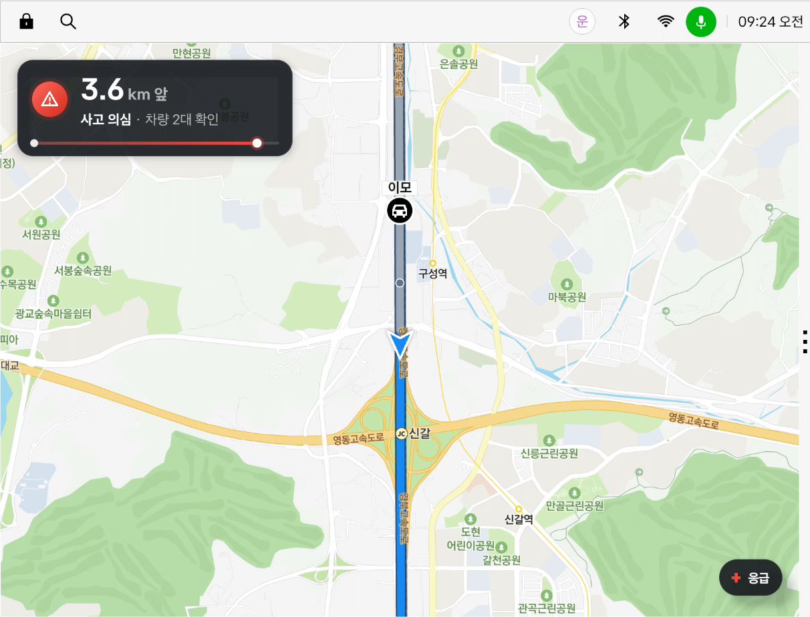
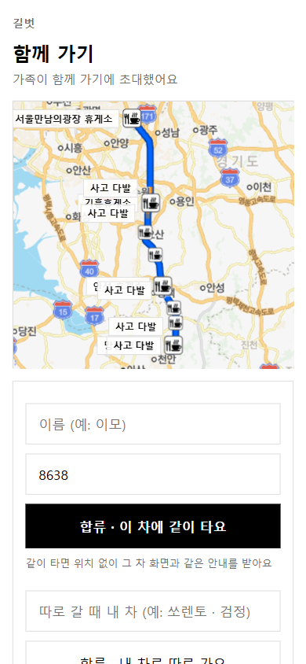
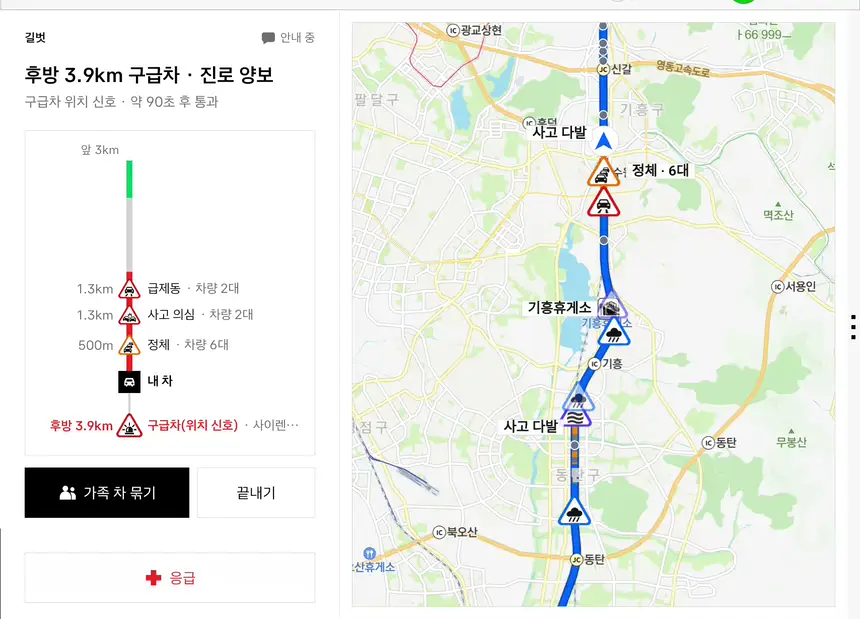
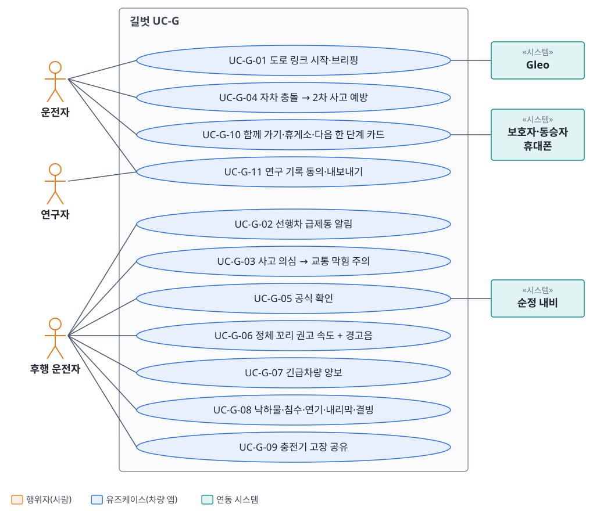
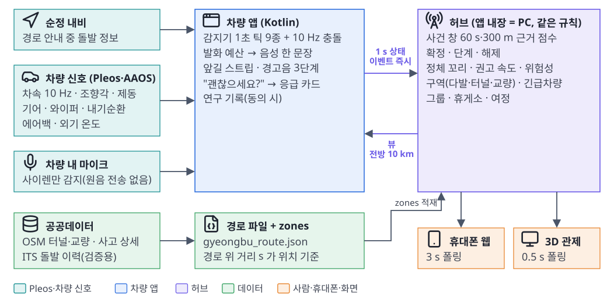
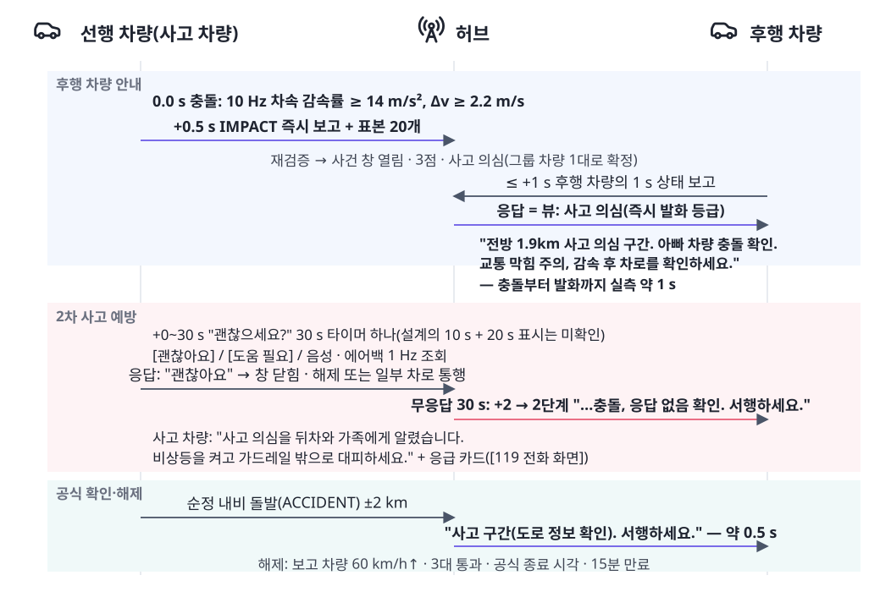
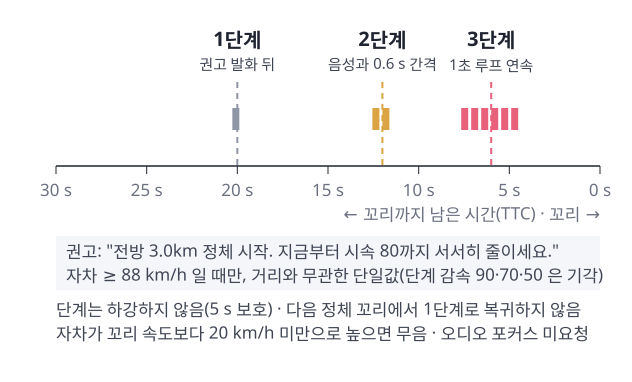
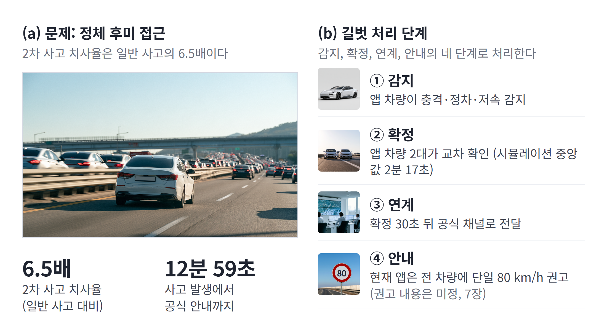
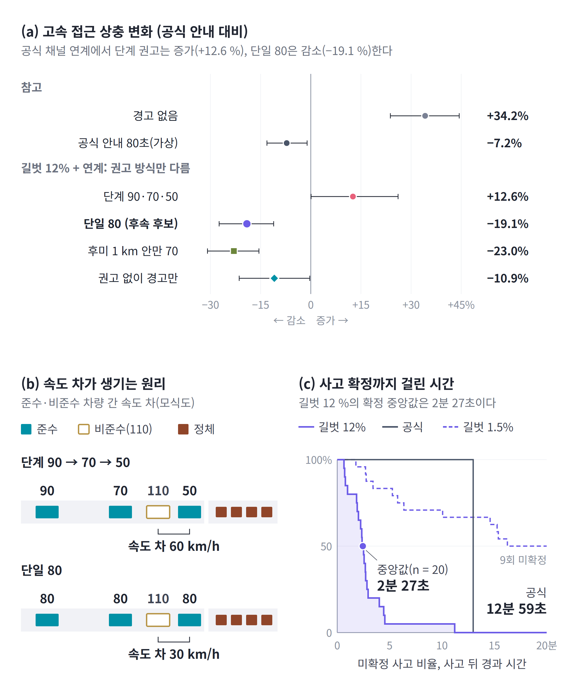

# 길벗 (Gilbeot)

**같은 길을 달리는 차끼리 앞차가 겪은 위험을 뒤차에 먼저 알리는 Pleos Connect 차량용 앱 — 익명 차대차 도로 링크의 설계·구현·검증**

현대자동차그룹 Pleos Connect 차량용 앱 공모전 출품작 · 2026-11

> **5분 안에 써 보기** (Pleos Connect 에뮬레이터가 있을 때, 자세한 것은 6절)
> 1. `adb install -r -g apk/Meeos_Gilbeot_release.apk` — 새 에뮬레이터에서 권한 대화상자에 멈추면 6절의 `pm grant --user 10` 세 줄
> 2. 앱을 열어 첫 화면의 [함께 가기 시작]을 누른다
> 3. Virtual Console 에서 기어 D·가속(시속 80 km 안팎)으로 달리면 위험 안내가 차례로 나온다(정차 중에는 "주변 차량 0대"에 머문다)

<p align="center">
  
</p>

> **그림 1. 길벗 차 화면(Pleos Connect 에뮬레이터 녹화에서 앱 영역만 자름, 제출 APK 와 같은 코드의 길벗 판, 2026-11-14).**
> - **지도 위 판** "3.6 km 앞 · 사고 의심 · 차량 2대 확인"이 지금 운전자에게 말한 위험이다. 서로 다른 길벗 차 두 대가 같은 곳에서 같은 신호를 보냈다는 뜻이다. 모르는 차의 보고는 두 대가 모여야 안내한다. 판 아래 선은 그 위험까지 남은 거리다.
> - **지도**(TMAP)는 주행 중 내 차(파란 화살촉)를 가운데에 두고 따라간다. 위험·다른 길벗 차(이모)·사고 다발 구간이 같은 지도 위에 놓인다.
> - 화면은 지도가 주인인 한 장(시안 A4, 11-13 확정)이다. 오른쪽 아래에 [응급]이 있다.

## 요약

**배경.** 고속도로 2차 사고는 사고 지점이 아니라 그 뒤에 생기는 정체 꼬리에서 일어난다. 그러나 공식 돌발 정보는 사고가 나고 약 13분(공개 자료 두 평균의 합, 779 s)이 지나야 운전자에게 닿는다.

**방법.** 길벗은 같은 도로를 달리는 Pleos 차를 익명으로 잇는다. 차가 이미 가진 신호(차속 10 Hz, 조향각, 제동, 변속 단, 와이퍼, 내기순환, 에어백, 마이크)로 위험을 감지한다. 허브는 60 s·300 m 사건 창에서 근거 점수를 합산해 확정하고, 뒤차에 **한 문장**으로 알린다. 앞이 확실히 막히면 그 상류의 차에 우회 경로를 확인하라고 한 번 권한다. 경로는 앱이 바꾸지 않고, 운전자가 [우회 안내]를 누를 때 순정 내비가 다시 찾는다(3.6절). 같은 규칙을 PC(Python)와 차량 앱(Kotlin)에 두 번 구현하고, 대조 스크립트로 두 출력이 같은지 검사한다. 통신은 버전 표기(`gilbeot-road/1`)·JSON Schema 검증·RFC 9457 오류 형식을 갖추고, 위험 정보는 ETSI DENM 의 필드 의미를 따른다.

**결과.** 두 엔진 대조에서 모두 일치했다: 도로 링크 131/131, 긴급차량 153/153, 스키마 46/46, 시계 오차 9/9, 권고 속도 상한 32/32, 지역 단위 23/23(한국어·영어). 에뮬레이터 두 대 실측에서 앞차 충돌부터 뒤차 음성 안내까지 약 1 s, 공식 확인 반영은 약 0.5 s 였다. 정체 꼬리 권고는 처음에 거리별 단계 감속(90·70·50)이었으나, 사전 등록 SUMO 시뮬레이션에서 이 방식이 고속 접근 상충을 늘려 단일 80 km/h(제한속도가 더 낮으면 그 값)로 바꿨다. 사전 등록 탐지 시뮬레이션(차량 신호 기반 고속도로 사고 탐지 보고서, 씨앗 24개)에서 앱 차가 12 % 일 때 사고 24건 가운데 60 s 안 확정은 길벗 규칙 8건, 같은 규칙에서 충돌·무응답 신호만 뺀 것 3건이었다(차이 +0.21, 95 % 신뢰구간 0.02–0.39, 등록 기준의 판정은 '불확실'). 차이는 모두 사고 차 자신이 앱 차였던 5건에서 나왔고, 길벗 규칙은 사고 없는 실행과 이동 병목을 사고로 읽지 않았다(오경보 0건). 후속 단계인 우회 안내 실험(실제 도로망, 격자 612회)에서는 차량당 평균 지연이 −0.09 %(95 % CI [−0.74, 0.59])로, 10 % 이상의 감소는 배제되었고 그보다 작은 효과는 가리지 못했다.

**한계.** 실차 검증이 없다. 에어백·순정 내비 돌발 정보·실제 사이렌은 에뮬레이터에서 값을 얻을 수 없어 시연용 훅(adb 셸 전용)으로 주입했다. 인증·TLS 는 구현하지 않았고 CI 는 없다. 시뮬레이션의 권고 효과는 공식 안내 지연 가정에 크게 의존하고(4.2절), 탐지의 추가 성능은 사고 차가 앱 차인 경우에 한한다(4.1절).

| 항목 | 내용 |
|---|---|
| 앱 이름 | 길벗 (Gilbeot), 패키지 `ai.meeos.gilbeot` |
| APK | [`apk/Meeos_Gilbeot_release.apk`](apk/) — 허브를 앱 안에 넣어 단독 실행 |
| 차량 신호 기반 고속도로 사고 탐지 보고서 | (접수 서류와 함께 따로 제출) 요약 2쪽 `미오스_길벗_차량신호_고속도로사고탐지_보고서_요약.pdf` · 전문 77쪽 `미오스_길벗_차량신호_고속도로사고탐지_보고서.pdf` — 차량 신호가 사고 탐지에 더하는 정보(사전 등록 시뮬레이션·국가 돌발 이력 대조)와 후속 단계인 우회 안내 실험 |
| 경고 방식 보고서 | (접수 서류와 함께 따로 제출) 요약 2쪽 `미오스_길벗_차내 정체 후미 경고의 권고 방식과 고속 접근 상충_보고서_요약.pdf` · 전문 70쪽 `미오스_길벗_차내 정체 후미 경고의 권고 방식과 고속 접근 상충_보고서.pdf` · 보충 자료 `미오스_길벗_차내 정체 후미 경고의 권고 방식과 고속 접근 상충_보고서_보충자료.pdf` — 정체 후미 경고의 권고 방식(사전 등록 시뮬레이션) |
| 주차 층 자동 판정 보고서 | (접수 서류와 함께 따로 제출) 요약 2쪽 `미오스_길벗_주차 층 자동 판정_보고서_요약.pdf` · 전문 32쪽 `미오스_길벗_주차 층 자동 판정_보고서.pdf` — 여러 차의 기록으로 지하 주차 층을 자동 판정하는 조건(사전 등록 시뮬레이션·건축물대장 대조) |
| 개발 보고서 | 접수 서류로 별도 제출 |

## 목차

1. [개요](#1-개요)
2. [시스템 구성](#2-시스템-구성)
3. [핵심 규칙](#3-핵심-규칙)
4. [연구: 차량 신호 기반 고속도로 사고 탐지 보고서·경고 방식 보고서·주차 층 자동 판정 보고서](#4-연구-차량-신호-기반-고속도로-사고-탐지-보고서경고-방식-보고서주차-층-자동-판정-보고서)
5. [검증](#5-검증)
6. [실행 방법](#6-실행-방법)
7. [저장소 구성](#7-저장소-구성)
8. [한계와 남은 일](#8-한계와-남은-일)
9. [데이터 출처와 라이선스](#9-데이터-출처와-라이선스)

## 1. 개요

### 1.1 설계 원칙

1. **차가 이미 가진 신호만 쓴다.** 새 센서를 붙이지 않는다. 이름·위경도·사이렌 원음은 링크로 보내지 않고, 위치는 경로 위 거리 s 로만 주고받는다. 위치 권한은 휴게소 주차와 본선 정차를 구분하는 데만 쓰며, 위치는 차 안에서 계산하고 경로 이탈 여부(불리언 하나)만 보낸다.
2. **사고는 '의심'으로만 말한다.** 판정 근거를 둘까지 함께 읽어 주고, 공식 정보가 겹칠 때만 한 단계 올린다.
3. **한 번에 한 문장.** 안내는 "전방 거리 · 무엇 · 누가 확인 · 행동" 순서의 내비 안내체다. 발화 예산을 넘는 정보는 화면에만 둔다.
4. **두 구현, 한 규칙.** 같은 규칙과 상수를 PC 엔진과 앱 내장 엔진에 두고, 대조 스크립트로 출력이 같은지 검사한다.

### 1.2 화면 한눈에 보기

<table>
<tr>
<td width="60%"></td>
<td align="center" width="20%"></td>
<td align="center" width="20%"></td>
</tr>
<tr>
<td><b>(a) 긴급차량 접근.</b> 판 "1.7 km 뒤 · 구급차 · 진로 양보 · 약 20초". 지도의 빨간 표지 "구급차(위치 신호)"가 같은 구급차이고, 화면 아래 붉은 빛은 긴급차량 안내 중에만 켜진다. 이 판에는 버튼이 없다.</td>
<td><b>(b) 함께 가기 합류.</b> 가족은 4자리 코드로 휴대폰 웹에 합류한다. 설치는 없다. 같은 차에 탄 사람은 [합류 · 이 차에 같이 타요]로 위치 없이 그 차 화면과 같은 안내를 받고, 따로 가는 차는 차 이름을 함께 적는다.</td>
<td><b>(c) 그룹 화면.</b> 그룹 안에서만 이름·위치를 보인다. 다같이 들를 휴게소와 '다음 한 단계' 카드를 여기서 고른다.</td>
</tr>
</table>

> **그림 2. 주요 화면.** (a)는 차 화면의 앱 영역(에뮬레이터 녹화에서 왼쪽 운전자 화면을 빼고 자름, 11-14), (b)(c)는 휴대폰 웹 화면(PC 브라우저 390×844 로 차의 내장 허브에 연결, 11-14)이다. 휴대폰 화면도 차 화면과 같은 문법(상태 한 줄 → 지도 → 버튼)을 쓴다.

<p align="center"></p>

> **그림 3. 실제 앱 녹화(에뮬레이터 화면 녹화 45초를 3배속, 앱 영역만, 11-14).** 시연 도로에서 구급차가 뒤에서 다가오는 동안 판이 "3.3 km 뒤 · 구급차 · 진로 양보 · 약 80초"에서 "300 m 뒤 · 약 10초"까지 줄어든다. 구급차 휴대폰의 위치 신호를 허브가 받아, 같은 방향 뒤쪽 5 km 안의 길벗 차에 나눠 준 결과다. 편집 없이 앱이 그린 화면 그대로다.

### 1.3 누가 무엇을 하나

<p align="center"></p>

> **그림 4. 유즈케이스(UC-G).** 앞차의 운전자는 아무것도 누르지 않는다. 차가 이미 가진 신호가 보고가 된다. 뒤따르는 운전자(아래쪽 행위자)가 안내를 받는 쪽이다. 운전자는 도로 링크를 켜고(UC-G-01), 자기 차가 충돌하면 "괜찮으세요?"에 답한다(UC-G-04). 보호자·동승자는 휴대폰으로 그룹에 합류하고(UC-G-10), 순정 내비는 공식 돌발 정보로 사고 의심을 확인한다(UC-G-05). 연구 기록(UC-G-11)은 운전자가 동의할 때만 켠다.

## 2. 시스템 구성

<p align="center"></p>

> **그림 5. 구성 요소와 데이터 흐름.**
> - **입력(왼쪽 열).** 순정 내비는 경로 안내 중 받은 돌발 정보를 준다. 차량 신호는 Pleos Vehicle SDK·AAOS 로 읽은 차속·조향·제동 등이다. 마이크는 사이렌인지 아닌지만 차량 앱에 넘긴다.
> - **차량 앱(가운데).** 1초 틱으로 감지기 9종을 돌리고, 충돌만 10 Hz 차속으로 따로 본다. 1초마다 상태(경로 위 거리 s·속도·와이퍼·외기 온도·제한속도)를 허브에 보내고, 위험 사건은 즉시 보낸다.
> - **허브(오른쪽).** 허브의 응답이 곧 그 차 기준의 **뷰**다. 뷰에는 전방 10 km 위험, 500 m 칸 20개, 권고 속도, 위험성, 구역이 들어 있다. 허브는 앱 내장(`LinkHub.kt`, 127.0.0.1:8790)과 PC(`link_server.py`, :8788) 두 구현이 같은 규칙을 공유한다.
> - **화면과 데이터(아래).** 휴대폰 웹은 3초, 3D 관제는 0.5초 간격으로 폴링한다. 공공데이터는 빌드 스크립트를 거쳐 경로 파일(`gyeongbu_route.json` + zones)로 허브에 실린다.

처리는 네 단계로 이어진다.

| 단계 | 어디서 | 무엇을 |
|---|---|---|
| ① 감지 | 차량 앱 | 급제동·급조향·충돌·정차·와이퍼·후진·내기순환·사이렌을 감지해 즉시 또는 1 s 주기로 보고 |
| ② 확정 | 허브 | 60 s·300 m 사건 창에 근거 점수를 합산. 그룹 차는 1대, 모르는 차는 2대로 확정 |
| ③ 안내 | 뒤차 | 뷰(응답)에 실린 위험을 발화 예산 등급에 따라 한 문장으로 말함 |
| ④ 공식 확인 | 허브 | 순정 내비 돌발 정보가 ±2 km 안에 있으면 "사고 구간(도로 정보 확인)"으로 올리고, 공식 종료 시각에 거둠 |

**통신 규격.** HTTP + JSON 폴링이다(앱 내장 허브는 HTTP/1.1, PC 허브는 HTTP/1.0 으로 응답한다. 요청마다 연결을 닫는 폴링이라 동작 차이는 없다). 모든 응답에 API 버전 `gilbeot-road/1` 이 실리고, 도로 링크 요청은 [`server/link/schema/`](server/link/schema/)의 JSON Schema(Draft 2020-12)로 두 허브가 같은 판정을 낸다. 오류는 RFC 9457 형식(`type`·`title`·`status`·`detail`)이다. 위험 항목은 ETSI DENM 의 필드 의미(`causeCode`, `informationQuality`, `detectionTime`, `validityDuration`, `eventPosition`, `relevanceDistance`)를 따른다. Pleos 서드파티 앱은 차량 간 직접 무선통신(V2X 무선)을 쓸 수 없어 DENM 인코딩 자체가 아니라 그 의미를 HTTP 위에 옮겼다.

### 2.1 쓰는 차량 정보

모두 읽기만 한다(차를 제어하지 않는다). 실차 확인은 없고, 확인 상태는 에뮬레이터 기준이다.

| 차량 정보 | 쓰는 곳 | 확인 |
|---|---|---|
| 차속(10 Hz)·기어 | 급제동·충돌 감지, 정체 꼬리 권고 속도·경고음, 정차 판단 | 에뮬레이터 |
| 조향각·브레이크 | 낙하물 의심, 긴 내리막, 길 비킴, 주차장 경사로 회전 | 에뮬레이터 |
| 와이퍼·외기 온도 | 폭우, 교량 결빙 주의 | 에뮬레이터(온도는 시험 입력도) |
| 공조 내기순환·창문 위치 | 연기·매연 의심, "창문을 닫아 주세요" | 에뮬레이터 |
| 에어백 전개 | 사고 근거 | 시험 입력(에뮬레이터에 없음) |
| 방향지시등·하향등 | 길 비킴, 주차장 입구 단서 | 방향지시등 에뮬레이터, 하향등 미확인 |
| EV 충전구·충전 상태·배터리 | 충전기 고장·대기 공유 | 에뮬레이터 + 시험 입력 |
| 마이크(기기 안 판별, 원음 저장 없음) | 사이렌 보조 근거 | 에뮬레이터(시험 소리) |
| 순정 내비(경로·제한속도·돌발 정보)·TTS·STT | 휴게소·우회 안내, 공식 확인, 음성 안내·답 | 에뮬레이터(제한속도 미확인, 돌발 정보는 시험 입력) |
| 차 GPS·관성 센서(있으면) | 휴게소 판정, 응급 카드, 주차 층 | GPS 에뮬레이터. 관성 센서는 Pleos SDK 2.3.2 목록에 없고 실차에서 읽히는지 미확인 — 있으면 쓰도록 구현, 에뮬레이터 주입 시험만 |

## 3. 핵심 규칙

### 3.1 감지하는 위험

| 위험 | 차가 감지하는 조건 | 근거 신호 |
|---|---|---|
| 급제동 | 18 km/h 이상에서 1초 사이 3 m/s 이상 감속, 다음 1초에도 낮게 유지 | 차속 |
| 정체 | (허브) 30 km/h 미만 20초 이상, 60 km/h 넘으면 해제 | 차속 흐름 |
| 사고 의심 | 사건 창 근거 점수 합산(3.2절) | 차속 10 Hz·조향·에어백·통신·운전자 응답 |
| 폭우 | 와이퍼 연속 작동(간헐·워셔 제외) | 와이퍼 |
| 침수·통행 불가 의심 | 도로 위 후진 기어 3초 이상, 1 km 안 2대 | 변속 단 |
| 낙하물·포트홀 의심 | 40 km/h 이상에서 1초 사이 핸들 60° 이상, 제동 없음 | 조향각·제동 |
| 연기·매연 | 공조 내기순환 켬, 1 km 안 2대(10분 유지) | 공조 |
| 긴 내리막 | 30 km/h 이상에서 제동 20초 이상 | 제동 |
| 긴급차량(구급차·소방차·경찰차) | 긴급차량 위치 신호, 뒤차들이 들은 사이렌, 앞차들의 길 비킴 | 휴대폰 GPS·마이크·차속·방향지시등 |
| 충전기 고장 의심 | 정차 중 충전구를 열고 90초 넘게 충전이 시작되지 않음 | EV 충전 상태 |

모르는 길벗 차의 보고는 서로 다른 두 대 이상이어야 확정하고, 가족 그룹 차의 보고는 한 대로 확정한다. 와이퍼·후진 변속·조향·내기순환·에어백은 휴대폰 앱이 읽을 수 없는 신호다. 이 기능이 휴대폰이 아니라 차량 앱이어야 하는 이유가 여기에 있다.

### 3.2 사고 판단: 근거 점수 합산

<p align="center"></p>

> **그림 6. 사고 의심의 근거 점수.**
> - **사건 창.** 한 차에서 첫 근거가 나온 때부터 60 s·300 m 를 하나로 묶고, 그 안의 근거 점수를 더한다.
> - **사고 의심 조건.** 합계가 3 이상이고, 빨간 막대(충돌·정차 30 s·에어백·통신 끊김) 가운데 하나 이상이 들어 있어야 한다. 회색 근거(급제동·급조향·무응답)만으로는 아무리 쌓여도 사고 의심이 되지 않는다. 급정거만 한 차를 사고로 부르지 않기 위해서다.
> - **충돌 감지.** 10 Hz 차속에서 두 표본 사이 감속률이 14 m/s² 이상인 상태가 0.5 s 유지될 때다. 14 m/s²(1.4 g)는 제동 한계 약 1.1 g 보다 높게 잡은 값이다. 감지 즉시 보고하고, 허브가 표본 20개로 다시 검증한다.
> - **확정.** 그룹 차는 1대, 모르는 차는 2대가 필요하다. 다만 점수 6 이상에 무응답이나 에어백이 있으면 모르는 차 1대로도 확정한다.

### 3.3 충돌에서 뒤차 안내까지

<p align="center"></p>

> **그림 7. 충돌 한 건의 처리 순서.** 세 개의 띠가 시간 순서다.
> - **첫 띠(후행 차량 안내).** 앞차가 0.0 s 에 충돌을 감지하면 0.5 s 안에 표본 20개와 함께 허브에 보고한다. 허브는 재검증한 뒤 사건 창을 열고 사고 의심으로 올린다. 뒤차가 1초 상태 보고를 보내면 응답(뷰)에 사고 의심이 실려 있다. 뒤차는 바로 "전방 1.9km 사고 의심 구간. 아빠 차량 충돌 확인. 교통 막힘 주의, 감속 후 차로를 확인하세요."라고 말한다. 에뮬레이터 두 대 실측에서 충돌부터 이 발화까지 약 1 s 였다.
> - **둘째 띠(2차 사고 예방).** 사고 난 차에는 "괜찮으세요?"를 묻고 30초를 기다린다. 무응답이면 근거 +2 로 2단계 안내가 나간다. 사고 차에는 비상등·가드레일 밖 대피 안내와 응급 카드가 뜬다. 응급 카드는 119 다이얼만 열고 자동 발신은 하지 않는다.
> - **셋째 띠(공식 확인·해제).** 순정 내비가 같은 구간 ±2 km 의 ACCIDENT 돌발을 받으면 "사고 구간(도로 정보 확인)"으로 올린다(약 0.5 s). 보고 차가 다시 달리거나, 세 대가 지나가거나, 공식 종료 시각이 되면 안내를 거둔다.

### 3.4 정체 꼬리 권고 속도와 접근 경고음

<p align="center"></p>

> **그림 8. 정체 꼬리 접근 경고.**
> - **정체 꼬리.** 앞차 두 대 이상이 40 km/h 미만인 첫 500 m 칸이다.
> - **권고.** 꼬리까지 거리와 무관하게 **시속 80 하나**만 권한다. "전방 3.0km 정체 시작. 지금부터 시속 80까지 서서히 줄이세요."라고 말하며, 내 속도가 88 km/h 이상일 때만 말한다. 순정 내비가 알려 주는 제한속도가 80 보다 낮으면(공사 구간 등) 그 값으로 낮춰 말한다.
> - **경고음.** 가로축은 꼬리까지 남은 시간(TTC)이다. 20 s 에 1단계(권고 발화 뒤 짧은 음), 12 s 에 2단계(음성과 0.6 s 간격), 6 s 에 3단계(1초 루프 연속)가 울린다. 단계는 내려가지 않는다(5 s 보호). 내 속도가 꼬리 속도보다 20 km/h 넘게 빠르지 않으면 울리지 않는다.
> - **단일값으로 바꾼 이유.** 처음 설계는 거리별 단계 감속(90·70·50)이었다. 4.2절의 시뮬레이션에서 이 방식이 따르는 차와 따르지 않는 차의 속도 차를 키워 고속 접근 상충을 늘렸다.

### 3.5 발화 예산과 긴급차량

**발화 예산.** 기능마다 따로 말하던 시절에는 72초에 16문장이 나왔다. 지금은 한곳(`RoadLinkController.onView`)에서 무엇을 말할지 고른다.
1. **바로 말함:** 긴급차량, 사고 의심, 3 km 안 급제동
2. **조용할 때만:** 나머지 위험(종류별 행동 거리 안), 권고 속도, 비 예보, 위험성. 도로 시간 30초에 한 문장
3. **화면에만:** 행동 거리 밖의 위험, 사고 다발 구간

**긴급차량.** 근거가 셋이다.
- 긴급차량(구급차·소방차·경찰차) 휴대폰이 보내는 **위치 신호**(그림 3)
- 뒤차들이 들은 **사이렌**: 차 안 마이크에서 YAMNet(Apache-2.0)으로 판별하고, 원음은 저장·전송하지 않는다.
- 앞차들의 **길 비킴**

같은 방향 뒤쪽에서 다가올 때만 "후방 1.9km 긴급차량 접근 중. … 진로를 양보하세요."라고 말한다(도로교통법 제29조 표현). 사이렌 검출률은 [`tools/siren_eval/README.md`](tools/siren_eval/README.md)에 차 밖·차 안 조건별로 정리했다. 한국식 사이렌 패턴을 실제 차 안에서 녹음해 검증한 적은 없다. 남은 일은 실차 녹음이 아니라, 녹음한 사이렌 음원을 정해진 거리·소음 조건으로 다시 트는 재현 실증이다(8장).

**보조 기능(2026-11-13 추가).**
- **긴급차량 세 종류.** 구급차·소방차·경찰차 휴대폰이 같은 위치 신호를 보낸다(`vtype`). 차종은 안내 문구만 바꾸고 양보 판단·우선순위는 같다. 모르는 값은 구급차로 본다.
- **긴급차량 시각 배너.** 소리를 못 듣는 운전자를 위해 화면 맨 위에 "긴급차량 접근 · 진로를 양보하세요"를 흑백 반전으로 겹쳐 띄운다. 레이아웃을 밀지 않고 버튼을 가리지 않으며 깜빡이지 않는다.
- **응급 카드의 장소.** 도로명·방향·가까운 나들목·휴게소를 한 장에 보여 준다(119 통화 때 그대로 읽는 화면). 충돌 뒤 운전자가 응답하지 않으면 이 카드와 119 다이얼 화면이 자동으로 뜨지만 **발신은 하지 않는다**.
- **이번 주행 요약.** 주행을 끝낼 때 알린 위험 수와 확인된 수를 한 장으로 보여 준다.
- **[경고 틀림] 기록.** 운전자가 방금 경고가 틀렸다고 눌러도 앱의 판단은 바꾸지 않고 기록만 남긴다(오경보율 측정용).
- **시연 한 바퀴.** 시연 빌드에만 있는 버튼으로, 시연 도로를 한 바퀴 돈다.
- **긴급차량 예상 경로(추정).** 뒤차들이 줄줄이 비키는 물결로 긴급차량이 확인되고 같은 방향으로 20초 넘게 이어지면, 앞쪽에서 가장 가까운 응급실 나들목까지 있는 차에게 화면에만 "긴급차량 올 수 있음 · ○○나들목 방향 추정"을 보인다(말하지 않는다). 위치 신호에 목적지가 있으면 그 목적지까지다. 구급차가 현장으로 가거나 소방차·경찰차면 병원과 무관하므로 문구를 약하게 두고, 방향이 끊기면 바로 거둔다. 가까운 범위의 안내는 그대로다.
- **내 위치와 목적지.** 첫 화면 지도의 내 위치 점은 차(기기)의 실제 위치이고, 위치를 못 받으면 점 없이 "위치를 받는 중"을 보인다. 판의 "어디로 갈까요?"에 장소 이름을 적으면 실제 위치 둘레의 TMAP 장소 검색 결과가 그대로 나오고(여기서 곧은 거리와 함께), 고르면 TMAP 길 찾기로 실제 위치 → 목적지 경로를 지도에 그리고 "실제 경로 N km · 약 M분"을 보이며 말한다. 함께 가기·위험 공유는 시연 경로(경부고속도로 하행) 위에서만 돈다 — [함께 가기 시작]을 누를 때 실제 위치가 그 시연 출발 자리와 다르면 "시연 구간 경부고속도로 하행에서 함께 가기를 보여 드립니다"라고 알리고 판에 "시연 주행 · 경부고속도로 하행"을 띄운다. 실제 주행 안내는 순정 내비가 하며, 목적지는 GPS 로 실제 차임이 확인될 때만 순정 내비에 넘긴다. 목적지는 정차(기어 P) 때 고른다 — 기어 D 에서는 검색 칸이 흐리게 보이고 "정차(P) 때 검색할 수 있어요"라고 알린다.
- **주행 화면.** 주행 중에는 내 차가 파란 화살촉으로 지도 가운데에 머물고(위험이 2.5 km 안이면 내 차와 위험을 함께 보이게 맞춤), 손으로 지도를 옮기면 [내 위치]가 나타나 8초 뒤 저절로 돌아온다. 한 줄 알약을 누르면 [끝내기]가 펼쳐진다. 끝내면 이 연결이 순정 내비에 넘긴 안내만 끈다.
- **음성.** 안내는 Pleos TTS(내비 안내 용도)로 말한다: 시작·목적지·앞쪽 위험·긴급차량·우회·일행 휴게소·도착·주차 층·연결 끊김·끝. 같은 위험은 한 번만 말한다. 앱 안에 음성 끄기는 두지 않았다(위험 경고까지 꺼지므로 — 음량은 Pleos 시스템 음량을 따른다).
- **주차 위치 기억(층·기둥).** 지하 주차장 입구에서 GPS 가 끊긴 뒤 차속·조향각으로 나선 경사로를 몇 바퀴 돌았는지 세어 층을 추정한다(한 바퀴 = 한 층). 기어 P 에서 "주차 B3(추정)"을 정차 중에만 보여 주고 [고치기]로 바로잡는다. 가족 휴대폰이 기둥을 찍어 보내면 차가 기기 안에서 글자(`B3`·`지하 2층`·`C-12`)를 읽어 "주차 B3 · C-12"로 확정하고 사진은 버린다. 직선 경사로·평면 주차장은 '층 모름'으로 둔다. 확실하지 않으면 "주차 B2~B3(추정) · 사진으로 확인"처럼 범위로 보여 준다. 건물 층수(국토교통부 건축물대장)는 약한 단서로만 쓴다 — 추정이 대장보다 깊으면 잘라 내지 않고 "B2~B3 · 대장과 다름 · 사진으로 확인"처럼 범위로 보인다(현장 층 표기가 대장과 어긋나는 건물이 있다). 공공데이터 키는 TMAP 앱키와 같이 APK 에 들어가는 공모전 전용 키이며 심사 뒤 폐기·재발급한다. 조향비·한 층의 회전량은 실차로 맞춰야 한다(실차 미검증). 차에 관성 센서(가속도·자이로)가 있으면 경사로 기울기와 내려간 높이로도 센다. 다만 차 관성 센서는 Pleos SDK 2.3.2 목록에 없고, 실차 헤드유닛에서 안드로이드 센서로 읽히는지는 확인하지 못했다 — 있으면 쓰도록 구현했고 에뮬레이터 주입 시험만 했다. 관성 센서 경로에서 높이는 경사 구간에서만 더하고(평지의 작은 기울기 오차가 쌓이지 않게), 첫 경사로로 내려가는 높이(4.5 m)를 층고(3.3 m)와 따로 두어 층을 세며(값은 실차 보정 필요), 정차가 3초 이어지면 자이로 영점을, 여러 주행에 걸쳐 장착 기울기를 다시 맞춘다.

<p align="center"></p>

> **그림 9. 시연 영상용 Unreal Engine 렌더(실시간 재생).** 길벗 시연 영상의 긴급차량 장면을 위해 Unreal Engine 5 로 만든 세 컷이다(앞모습 → 지붕 경광등 → 뒤따라가는 장면). 한국 구급차 규격대로 경광등은 빨간색 단색이다. 이 그림은 영상 연출용 렌더이며 앱이 그리는 화면이 아니다. 앱이 실제로 그리는 화면은 그림 3 이다.

### 3.6 최소 우회 안내

앞이 확실히 막혔을 때 그 상류의 차에 한 번만 알린다. 경로는 앱이 스스로 바꾸지 않는다.

- **언제.** 사고 의심이나 정체가 **확정**되고, 막힘까지 10 km 이하이며, 다음 나들목이 1 km 이상 앞에 있고 그 나들목이 막힘보다 앞일 때다(나가려면 막힘을 지나야 하는 경우는 권하지 않는다). 나들목 10곳은 OpenStreetMap 의 고속도로 진출 지점으로 경로 파일에 넣었다.
- **무엇을.** 권고를 받는 차(아래 '모두가 나가지 않게')에는 같은 막힘에 한 번, 발화 예산과 무관하게 "전방 3.6km 막힘 확정. 우회 경로를 확인하세요."라고 말하고 [우회 안내] 버튼을 보인다. 권고를 받지 않는 차는 본선에 머문다(권고 속도 안내는 그대로). 나들목 이름은 말하지 않는다. 어느 나들목으로 나갈지는 순정 내비의 재탐색이 정한다.
- **누르면.** 순정 내비가 경로 안내 중이면 재탐색(`requestReRoute`)을, 아니면 다음 나들목을 목적지로 경로 요청을 보낸다. 막힘 확정이 풀리면 버튼을 거둔다.
- **모두가 나가지 않게.** 허브는 우회 비율 p(지금은 0.5 고정 — 허브가 우회로 용량을 모른다)와 차마다 배정(차 id 와 막힘 id 의 해시로 우회·본선 유지)을 보기에 싣는다. 우회에 배정된 차는 지난 권고를 따른 비율로 만든 준수 점수가 기준을 넘을 때만 권고를 받는다. 준수 점수는 차 안에만 두고 허브에는 수락·거절만 보낸다. 따름 여부는 차 안에서 GPS 로 경로에서 1 km 넘게 벗어났는지로만 판단하며, 위치 값은 보내지 않는다.
- **같은 규칙.** 허브 두 구현과 차량 신호 기반 고속도로 사고 탐지 보고서의 우회 시뮬레이션이 같은 상수(10 km·1 km·같은 막힘 1회·확정 뒤 2 s·p)를 쓰며, 상수 대조 스크립트가 값이 같은지 검사한다(`tools/check_engine_consts.py` 의 우회 짝).
- **확인하지 못한 것.** 에뮬레이터에서는 재탐색 요청이 순정 내비까지 가는 것만 확인했다. 순정 내비가 실제로 우회 경로를 잡는지, 차 안 GPS 로 한 따름 판정이 실차에서 맞는지는 확인하지 않았다(8장).

## 4. 연구: 차량 신호 기반 고속도로 사고 탐지 보고서·경고 방식 보고서·주차 층 자동 판정 보고서

세 보고서 모두 가설·지표·판정 기준을 결과를 보기 전에 등록 문서에 적고 커밋한 뒤 실행했다(각 보고서의 방법 장과 부록의 등록 이력). 세 보고서은 설정이 다른 별도 실행이라 수치를 서로 바꿔 읽지 않는다. 보고서마다 2쪽 요약이 있으니 요약을 먼저 읽기를 권한다.

### 4.1 차량 신호 기반 고속도로 사고 탐지 보고서: 막힌 도로 탐지 → 뒷차 우회 안내 → 흐름 변화

차량 신호를 모아 뒤차에 알리는 발상은 새롭지 않다(메르세데스-벤츠 Car-to-X 2016–, 유럽 C2C-CC 규격). 이 보고서은 그 발상을 같은 조건에서 세 단계로 잰다. 1단계는 길벗의 판정 규칙이 같은 차들의 위치·속도만 쓰는 같은 규칙(G⁻)과 속도 프로브 기준 알고리즘보다 사고를 얼마나 먼저, 얼마나 정확히 아는지다. 2·3단계는 그 탐지로 상류 앱 차에 우회를 권했을 때(3.6절) 전체 차량의 지연과 주변 도로의 흐름이 어떻게 바뀌는지다. 안전 효과는 재지 않는다.

**1단계: 탐지(결과).**
- **방법.** 경부고속도로 실측 교통량을 넣은 SUMO 미시 시뮬레이션(씨앗 24개)에서 사고·사고 없음·사고 없는 이동 병목·전 차로 차단의 네 실행을 만들고, 경고를 내지 않는 관측자를 같은 교통류에 붙였다. 길벗 규칙 세 판(위치·속도만 G⁻, 충돌 신호 추가, 충돌과 무응답 추가 = G)과 속도 프로브 기준 알고리즘을 같은 보급률에서 읽었다. 주 비교는 보급률 12 % 에서 G 대 G⁻ 의 사고 뒤 60 s 안 검지율이다.
- **주 비교.** 사고 24건 가운데 60 s 안 확정은 G 8건, G⁻ 3건이었다(짝지은 차이 +0.21, 95 % 신뢰구간 0.02–0.39, 정확 McNemar p = 0.0625). 등록한 10 %p 기준의 판정은 '불확실'이다. 차이는 모두 사고 차 자신이 앱 차였던 5건에서 나왔고(G 5/5, G⁻ 0/5), 나머지 19건에서 두 규칙의 출력은 같았다.
- **기준 알고리즘.** 같은 입력을 500 m 칸·60 s 창으로 집계하는 프로브(40 km/h 문턱)는 60 s 안 9건, 검지 시간 중앙값 73 s 였다.
- **오경보.** 길벗 세 판은 사고 없는 실행과 이동 병목에서 오경보 0건이었다. 40 km/h 프로브는 이동 병목을 시간당 0.35건, 80 km/h 프로브는 5.2건 사고로 읽었다.
- **실측 대조.** 국가 ITS 돌발 이력과 사고 기록을 짝지은 경부선 140쌍에서 돌발 등록은 사고 기록보다 중앙값 88 s(Q1–Q3 14–247 s) 늦었다. 이 값은 등록 시각이며 전광판·내비로 배포되기까지의 지연은 들어 있지 않다(4.2절의 '약 13분'은 공개 자료 두 평균을 합한 가정값으로 정의가 다르다).
- **한계.** 현행 규칙은 완전 차단과 일부 통행을 가르지 못했고, 처리가 끝난 뒤에도 경고가 평균 616 s 남았다(24건 중 9건은 관측 끝까지 남음). 충돌·무응답 신호가 이상적으로 들어온다는 가정이다. 조건부 시뮬레이션 비교이며 실측 독립 검증이 아니다.

**2·3단계: 우회 안내와 흐름 변화(차량 신호 기반 고속도로 사고 탐지 보고서 부록 I).** 실제 도로망(경부고속도로 하행 50.2 km와 주변 간선·시내 도로)에서 막힘이 확정되면 상류 앱 차에 3.6절과 같은 규칙·상수로 우회를 권하고, 결과 전에 등록한 격자 612회를 실행했다. 길벗 안내의 전체 차량당 평균 지연은 안내 없음 대비 −0.09 %(95 % CI [−0.74, 0.59])였고, 등록한 크기 기준(10 %) 이상의 감소는 네 비교 모두에서 배제되었다. 그보다 작은 효과는 가리지 못했고, 권고를 따른 차는 분석 대상의 0.56 %였다.

차량 신호 기반 고속도로 사고 탐지 보고서: `미오스_길벗_차량신호_고속도로사고탐지_보고서.pdf`(별도 제출)

### 4.2 경고 방식 보고서: 정체 후미 경고의 권고 방식

<p align="center"></p>

> **그림 10. 연구 문제와 길벗의 처리 단계(경고 방식 보고서 그림 1).**
> - **(a) 문제.** 2차 사고의 치사율은 일반 사고의 6.5배다. 사고 발생부터 공식 안내까지는 약 13분(12분 59초)이 걸린다고 가정했다.
> - **(b) 길벗의 개입 순서.** 감지 → 앱 차량 2대의 교차 확정(시뮬레이션 중앙값 2분 17초) → 확정 30초 뒤 공식 채널 연계 → 전 차량에 일률 80 km/h 권고.

<p align="center"></p>

> **그림 11. 주요 결과(경고 방식 보고서 그림 2).**
> - **(a) 고속 접근 상충의 변화.** 공식 안내만 있는 기준선 대비 고속 접근 상충(TTC < 1.5 s, 속도 차 ≥ 30 km/h)의 변화와 95 % 신뢰구간이다. 길벗 12 % 보급 + 공식 연계에서 권고 방식만 바꿨더니, 단계 90·70·50 은 +12.6 % 로 늘었고 일률 80 은 −19.1 % 로 줄었다.
> - **(b) 원리.** 단계 권고를 따르는 차(보라)가 50 까지 줄이는 동안, 따르지 않는 차(회색, 110)는 그대로 달린다. 그래서 같은 구간의 속도 차가 60 km/h 까지 벌어진다. 일률 80 에서는 30 km/h 에 그친다.
> - **(c) 사고 확정까지 걸린 시간.** 길벗 12 % 의 중앙값은 2분 17초, 공식 채널은 12분 59초다.

**이 결과를 읽을 때의 조건.**
- 위 효과는 공식 안내가 779 s 지연된다는 가정에서의 값이다. ITS 돌발 등록 시각의 실측 분포(중앙값 88 s)에서 씨앗마다 네 번 추출해 합치면 일률 80 의 감소는 −7.9 % 로 줄어든다(신뢰구간은 0 을 벗어남).
- 운전자 추종 모형을 Krauss 에서 IDM 으로 바꾸면 두 권고의 우열이 뒤집힌다.
- 그래서 경고 방식 보고서은 이 결과를 "2차 사고 감소"로 주장하지 않는다. **이 모형 안에서 권고 내용이 상충의 종류별 증감을 바꾼다는 조건부 비교**로만 주장한다.
- 가설·지표·검정은 결과를 보기 전에 등록 문서에 적고 커밋했다(경고 방식 보고서 3장과 부록의 등록 이력).

경고 방식 보고서: `미오스_길벗_차내 정체 후미 경고의 권고 방식과 고속 접근 상충_보고서.pdf`(별도 제출)

### 4.3 주차 층 자동 판정 보고서: 지하 주차장의 주차 층 자동 판정

같은 주차장을 이용한 여러 차의 기록을 모으면 사람의 확인 없이 주차 층을 판정할 수 있는지를, 가정한 주차장 1,200곳의 사전 등록 시뮬레이션 두 차례로 평가했다. 시험이 끝난 뒤에는 대도시 여섯 시군구의 건축물대장(표제부 112,022건)과 가정을 대조했다.

- 자동 판정을 좌우한 것은 차가 내려간 높이 신호였다(+62.6 %p). 선회만 쓰면 확인 기록 3,000건에도 28.8 %에 그쳤다.
- 건축물대장에 강한 사전 가중을 주면 자동 판정이 7.3 %p 줄었고, 약하게 반영하면 차이가 −0.9 %p로 한계 안이었다.
- 층 표기 전체가 바뀐 직후에는 방문의 85.1 %를 높은 확신도로 잘못 안내했다. 확인 기록만으로는 막지 못했다.
- 가설 열 개 가운데 지지 일곱, 지지 안 됨 셋이다. 실제 주차장과 실차 센서에서는 검증하지 않았다.

주차 층 자동 판정 보고서: `미오스_길벗_주차 층 자동 판정_보고서.pdf`(별도 제출)

## 5. 검증

| 무엇을 | 어떻게 | 결과 | 근거 |
|---|---|---|---|
| 두 엔진 일치 | PC `link_server.py` ↔ 앱 `LinkHub.kt` 같은 입력 대조(ko·en) | 도로 링크 131/131, 긴급차량 153/153, 스키마 46/46, 시계 오차 9/9, 권고 속도 상한 32/32, 지역 단위 23/23 | `server/link/check_link_parity.py` |
| 스키마 | 메타 스키마·두 허브 판정·실제 응답 대조 | 스키마 15개(Draft 2020-12), 판정 25/25 같음 | `server/link/schema/check_schemas.py` |
| 단위 시험 | 순수 로직(JUnit 4, 로컬 JVM) `./gradlew testDebugUnitTest -Pmeeos.edition=gilbeot` | 194건(실행 193 통과, 손으로 서버를 띄우는 도우미 1건 건너뜀, 실패 0) · 허브 파이썬 시험 47건 | `app/src/test/` |
| 충돌 → 뒤차 안내 | 에뮬레이터 2대, Virtual Console 시속 90→0 | 약 1 s | `server/link/crash_demo.sh` |
| 공식 확인 반영 | 순정 내비 돌발 주입 | 약 0.5 s | `server/link/official_demo.sh` |
| 차속 구독 주기 | `PERF_VEHICLE_SPEED` FASTEST 실측 | 10.2 Hz | `probe_signals` 훅 |
| 차량 신호의 탐지 정보(1단계) | 사전 등록 SUMO 시뮬레이션(씨앗 24개) + 국가 돌발 이력 140쌍 대조 | 4.1절 | 차량 신호 기반 고속도로 사고 탐지 보고서 |
| 우회 안내와 흐름(2·3단계) | 사전 등록 SUMO 시뮬레이션(실제 도로망, 격자 612회) | 4.1절(지연 −0.09 %, 10 % 이상 감소 배제) | 차량 신호 기반 고속도로 사고 탐지 보고서 |
| 권고 방식 | 사전 등록 SUMO 시뮬레이션 | 4.2절 | 경고 방식 보고서 |
| 주차 층 자동 판정 | 사전 등록 시뮬레이션(주차장 1,200곳) + 건축물대장 대조 | 4.3절 | 주차 층 자동 판정 보고서 |

> **표 읽는 법.** '두 엔진 일치'는 같은 입력에 대해 PC 엔진과 앱 내장 엔진의 출력(안내 문장·확정 여부·뷰)이 글자 단위로 같은지를 센 것이다. 규칙을 한쪽만 고치면 이 숫자가 깨진다. 실측 행은 모두 x86_64 에뮬레이터 값이며 실차 값이 아니다. 시험 항목 전체는 개발 보고서의 시험·품질 부록에 있다.

## 6. 실행 방법

**필요한 것**
- Pleos Connect 에뮬레이터(Android Automotive 14 / API 34, x86_64)와 Virtual Console
- 소스 빌드: JDK 17, Android SDK 37(compileSdk 37 · targetSdk 35), 저장소의 Gradle Wrapper(이 저장소의 기본 빌드는 길벗 판이다: `gradle.properties` 의 `meeos.edition=gilbeot`)
- PC 허브: Python 3.11 이상(표준 라이브러리만 사용, 3.13 에서 검증)
- 지도 타일·CDN 을 받기 위한 인터넷 연결

**설치와 실행.** 허브가 앱 안에서 돈다.

```bash
adb install -r -g apk/Meeos_Gilbeot_release.apk
```

`-g` 는 차 속도·마이크(사이렌 감지)·위치(휴게소 판정 — 차 안에서만 계산) 런타임 권한을 함께 준다. 차 화면에서 [함께 가기 · 앞차와 위험 공유]를 누르면 시연 도로(설 연휴 귀성길: 사고 → 정체 → 낙하물 → 내리막 → 비 → 터널 연기 → 침수)가 시작된다. 시연 도로는 **차가 움직여야** 진행된다. 아래 Virtual Console 에서 기어를 D 로 두고 ACCEL 을 누르고 있으면(시속 80 km 안팎) 주변 차와 위험 안내가 차례로 나온다. 정차 중에는 '함께 가기 연결됨 · 주변 차량 0대'에 머문다. 큰 속도에서 갑자기 0 으로 세우면 충돌로 감지해 '괜찮으세요?'를 묻는다([괜찮아요]로 닫는다). 새 에뮬레이터의 첫 실행에서는 대기 화면 지도가 뜨기까지 30초쯤 걸릴 수 있다.

**앱 안 서버 포트가 이미 쓰이고 있을 때.** 앱 안 서버는 포트 8790 을 쓴다. 다른 프로그램이 이 포트를 먼저 잡고 있으면 앱은 지도 자리와 토스트에 '앱 안 서버를 열지 못했습니다(포트 8790 사용 중)…'를 띄우고 함께 가기를 시작하지 않는다(`adb logcat -s Meeos` 에 '내장 서버 시작 실패'). 그 프로그램을 끄고(`adb shell am force-stop <그 앱 패키지>`) 이 앱을 다시 연다.

**새 에뮬레이터에서 첫 실행이 권한 대화상자에서 멈출 때.** Android Automotive 는 앱을 운전자 사용자(보통 10번)에서 돌려 `-g` 가 그 사용자에게 닿지 않을 수 있다(새로 만든 에뮬레이터 첫 설치에서 실제로 멈춘 기록이 있다). 사용자 번호를 확인하고, 다르면 아래의 `10` 을 그 값으로 바꾼다. 권한을 준 뒤 앱을 다시 연다. 런타임 권한은 이 셋(차 속도·마이크·위치)뿐이다(Pleos 차량 권한은 설치만으로 주어진다).

```bash
adb shell am get-current-user
```
```bash
adb shell pm grant --user 10 ai.meeos.gilbeot android.car.permission.CAR_SPEED
```
```bash
adb shell pm grant --user 10 ai.meeos.gilbeot android.permission.RECORD_AUDIO
```
```bash
adb shell pm grant --user 10 ai.meeos.gilbeot android.permission.ACCESS_FINE_LOCATION
```

**Virtual Console 열기.** 페달·기어·문·방향지시는 에뮬레이터의 Virtual Console 웹 화면으로 조작한다. 포트를 연 뒤 PC 브라우저에서 `http://127.0.0.1:8088/` 을 연다. 창이 작거나(1600×900 미만) 다른 창에 가려지면 페달 조작이 먹지 않을 수 있다.

```bash
adb forward tcp:8088 tcp:8088
```

**휴대폰 화면 보기.** 앱 내장 허브를 PC 로 연다.

```bash
adb forward tcp:8791 tcp:8790
```

[가족 차 묶기]를 누르면 참가 링크(`/link/<그룹>?code=`)가 `adb logcat -s Meeos` 에 뜬다(이 기록은 심사용 빌드 — 시연 훅 포함 — 에서만 찍힌다). PC 브라우저(휴대폰 크기)에서 `http://127.0.0.1:8791` 뒤에 붙여 연다. 합류 화면에서 [합류 · 이 차에 같이 타요]를 고르면 휴대폰 위치 없이 그 차 화면과 같은 위험 안내가 휴대폰에도 뜬다. [내 차로 따로 가요]는 휴대폰 위치가 필요한데, 시연 주소(HTTP)에서는 휴대폰 브라우저가 위치를 막는다. 3D 관제는 `/world?me=<차 id>` 다.

**PC 허브와 두 엔진 대조.**

```bash
python server/link/link_server.py
```
```bash
python server/link/check_link_parity.py http://127.0.0.1:8788 http://127.0.0.1:8791 ko
```

**두 차 라이브 시연**(앞차·뒤차 에뮬레이터 2대): [`server/link/crash_demo.sh`](server/link/crash_demo.sh)(충돌 → 뒤차 안내), [`server/link/official_demo.sh`](server/link/official_demo.sh)(공식 확인), [`server/link/twocar_demo.sh`](server/link/twocar_demo.sh). **제출 APK 하나로는 안 된다.** 제출 APK 는 허브를 앱 안에 두는 앞차·단독용이고, 뒷차는 앞차 에뮬레이터의 허브를 보는 APK 를 소스에서 따로 빌드해 두 번째 에뮬레이터에 설치해야 한다(주소는 빌드 때 정해지며 앱 안 설정이 없다). 열쇠 파일이 없으면 디버그 키로 서명된다.

```bash
./gradlew assembleRelease -Pmeeos.edition=gilbeot -Pmeeos.demo=true -Pmeeos.serverUrl=http://10.0.2.2:8791
```
```bash
adb -s emulator-5556 install -r -g app/build/outputs/apk/release/app-release.apk
```
```bash
adb -s emulator-5554 forward tcp:8791 tcp:8790
```

마지막 줄은 앞차(`emulator-5554`)의 내장 허브를 PC 의 8791 로 열어 뒷차가 `10.0.2.2:8791` 로 닿게 한다(에뮬레이터 이름은 `adb devices` 로 확인). 절차와 시연용 인텐트 훅은 개발 보고서의 운영 절차 부록에 있다.

**빌드.** 제출 APK 는 심사용 빌드(시연 훅 포함)다. 제품 빌드는 옵션 없이 빌드하며, 이때는 시연 인텐트·참가 링크 기록이 꺼진다.

```bash
./gradlew assembleRelease -Pmeeos.edition=gilbeot -Pmeeos.demo=true
```
```bash
./gradlew assembleRelease -Pmeeos.edition=gilbeot
```

## 7. 저장소 구성

| 위치 | 역할 |
|---|---|
| `app/` | 차량 앱(Kotlin, Jetpack Compose). `road/` 도로 링크, `car/` 차량 신호, `voice/` TTS·STT, `navi/` 순정 내비, `engine/` 앱 내장 허브(`LinkHub.kt`)와 HTTP 서버, `ui/` 화면, `siren/` 사이렌 모델 |
| `apk/` | 제출 release APK |
| `server/link/` | PC 허브(`link_server.py`), 휴대폰 웹(`link.html`), 3D 관제(`world.html`), 구급차 휴대폰 화면(`ambulance.html`), 요청 스키마(`schema/`), 경부선 경로·구역 데이터와 빌드 스크립트, 시연 스크립트 |
| `server/` 그 밖 | 앱 빌드가 함께 복사하는 공용 자산(지도·아이콘·지역 프로필) |
| `tools/siren_eval/` | 사이렌 검출 평가 스크립트와 결과(차 밖·차 안 조건) |
| `docs/` | 캡처·움짤(보고서 PDF 는 접수 서류와 함께 따로 제출) |

**문서 안내.**
- 처음 보는 사람: 이 README → 개발 보고서(접수 서류로 별도 제출)
- 연구 근거(접수 서류와 함께 따로 제출, 2쪽 요약 먼저): 차량 신호 기반 고속도로 사고 탐지 보고서 요약 `미오스_길벗_차량신호_고속도로사고탐지_보고서_요약.pdf` · 경고 방식 보고서 요약 `미오스_길벗_차내 정체 후미 경고의 권고 방식과 고속 접근 상충_보고서_요약.pdf` · 주차 층 요약 `미오스_길벗_주차 층 자동 판정_보고서_요약.pdf`. 전문: 차량 신호 기반 고속도로 사고 탐지 보고서 `미오스_길벗_차량신호_고속도로사고탐지_보고서.pdf` · 경고 방식 보고서 `미오스_길벗_차내 정체 후미 경고의 권고 방식과 고속 접근 상충_보고서.pdf` · 주차 층 자동 판정 보고서 `미오스_길벗_주차 층 자동 판정_보고서.pdf`
- 통신 규격: [`server/link/schema/`](server/link/schema/)(요청·응답 JSON Schema)
- 사이렌 평가: [`tools/siren_eval/README.md`](tools/siren_eval/README.md)

이 저장소의 앱 소스는 같은 코드에서 Gradle 판 분기(`meeos.edition`, `BuildConfig`)로 여러 판을 만드는 구조라, 이 판에서 꺼지는 기능의 코드도 함께 들어 있다. 이 저장소의 기본 빌드와 제출 APK 는 길벗 판이다.

## 8. 한계와 남은 일

- **실차 검증 없음.** 모든 측정은 x86_64 에뮬레이터 값이다. 에어백 전개·순정 내비 돌발 정보·EV 충전 상태·외기 온도·실제 사이렌은 에뮬레이터에서 값을 얻을 수 없어 시연용 훅으로 주입했다. 다음 단계의 검증도 실차 측정이 아니라 재현 실증으로 한다 — 에뮬레이터 두 대와 Virtual Console 신호 주입, 기록된 자료(사이렌 음원·공공 돌발 이력·시뮬레이션 기록)를 다시 틀어 같은 상황을 누구나 반복해 볼 수 있게 한다.
- **사이렌.** YAMNet 은 음색으로 판별한다. 차 밖 합성 시험에서도 패턴마다 검출률이 크게 달랐고(웨일 90 %, 옐프 26 %, 하이로 0 %, 문턱 0.7), 차 안 조건(차체 차음 + 주행 소음)에서는 더 낮았다. 실제 한국 구급차를 차 안에서 녹음해 확인하기 전에는 "마이크가 한국 구급차를 알아챈다"고 주장하지 않는다. 문턱은 녹음한 음원을 정해진 거리·소음 조건으로 다시 트는 재현 실증으로 다시 정한다.
- **보조 정보이며 운전 책임은 운전자에게 있다.** 앱의 안내(음성·화면·경고음)는 참고용이다. 앞길을 직접 살피고 교통법규를 지켜야 하며, 안내가 틀리거나 늦거나 나오지 않을 수 있다(실차 오경보율·지연은 측정하지 못했다).
- **119 는 자동으로 걸지 않는다.** 응급 카드의 [119 전화 화면]은 번호만 넣은 다이얼 화면을 열 뿐이며 발신은 사람이 한다. 사고 알림은 뒤차·가족에게만 가고 119 에는 가지 않는다.
- **보안.** 인증·TLS 가 없다. 내장 허브는 루프백 전용이다. 입력은 JSON Schema 로 검증한다. 제출 APK 는 심사 시연을 위해 시연 훅이 열린 빌드지만, 훅은 adb 셸만 보낼 수 있는 방송 수신기(`DUMP` 권한으로 보호)로만 들어오고 일반 앱의 인텐트로는 받지 않는다(제품 빌드는 이 수신기를 끈다). 같은 기기의 다른 앱이 방송을 보내면 시스템이 거부하는 것을 에뮬레이터에서 확인했다. 참가만 하면 차 한 대가 여러 대로 보일 수 있으며(차량 인증 없음) 허브 시계·초기화도 무인증이다. 구급차 위치 신호의 토큰은 저장소 코드에 값이 없다. 제품 빌드는 훅을 닫는다.
- **개인정보.** 차량은 경로 위 거리·속도·와이퍼 등 차량 신호만 보내고 이름·전화번호는 보내지 않는다. 휴대폰 참가자의 좌표는 허브가 받는 즉시 경로 위 거리로 바꾸고 좌표는 저장하지 않는다. 허브는 메모리에만 두며(디스크 저장·접근 로그 없음) 5분 소식이 없는 차의 보고는 거두고, 허브를 끄면 모두 사라진다. 앱의 연구 기록은 기기 안에만 두고 마지막으로 쓴 지 30일이 지나면 자동으로 지운다. 지도·경로·장소 검색을 부를 때는 차의 위치 좌표가 지도 서버(SK 티맵모빌리티)로 전달되므로, 제품 단계에서는 개인정보 처리방침의 제3자 제공 고지가 필요하다. 근거는 개발 보고서(접수 서류로 별도 제출)의 보안·개인정보 장.
- **시험.** 앱 단위 시험은 로컬 JVM 194건(실행 193·건너뜀 1·실패 0, 2026-11-13 실행 결과)이고 허브 파이썬 시험 47건이 있으며 CI 가 없다. 규칙이 같은지는 두 엔진 대조 스크립트로 검사한다.
- **시뮬레이션.** 탐지 이득은 사고 차가 앱 차인 경우에만 나타났고, 충돌·무응답 신호가 이상적으로 들어온다는 가정이다(4.1절). 우회 안내의 효과는 아직 결과가 없다. 권고 효과는 공식 안내 지연 가정과 추종 모형에 의존한다(4.2절). 실제 운전자의 준수율·주의 회복은 측정하지 않았다.
- **우회 안내.** 순정 내비가 재탐색 요청을 받아 실제로 우회 경로를 잡는지, 차 안 GPS 로 한 따름 판정이 실차에서 맞는지는 확인하지 않았다. 우회 비율 p 는 허브가 우회로 용량을 몰라 0.5 로 고정했다(3.6절).

## 9. 데이터 출처와 라이선스

- 지도·공공데이터의 출처와 이용 조건: [DATA_SOURCES.md](DATA_SOURCES.md) — OpenStreetMap ODbL, 공공누리 1유형, 한국도로공사·ITS 공개 자료 등
- 모델·3D 에셋: YAMNet Apache-2.0(`app/siren/README.md`), Kenney Car Kit CC0(`server/link/models/LICENSE-kenney.txt`). 그림 9 의 렌더에 쓴 구매·샘플 에셋은 파일 없이 출처만 [DATA_SOURCES.md](DATA_SOURCES.md) 2절에 적었다.
- 앱·서버가 쓰는 라이브러리·SDK: [THIRD_PARTY_NOTICES.md](THIRD_PARTY_NOTICES.md). TMAP·VSM SDK 바이너리(`app/libs/*.aar`)의 재배포 조건은 공식 약관에서 확인하지 못했다(같은 문서 2.1).
- 이 저장소 자체의 이용 조건: [LICENSE](LICENSE)
- 지도 화면 아래의 표기(© OpenStreetMap contributors 등)는 각 이용 조건을 따른 것이다.
