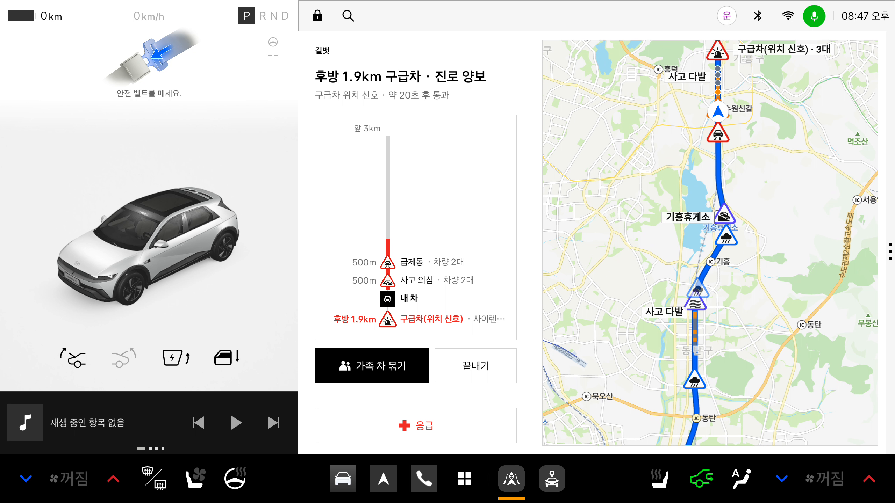
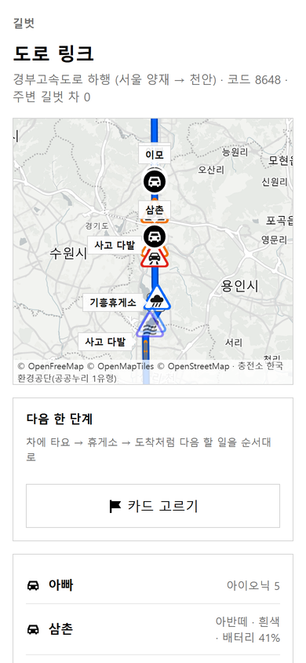
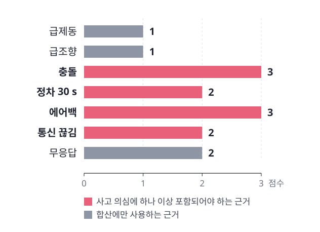

# 길벗 (Gilbeot)

**같은 길을 달리는 차끼리 앞차가 겪은 위험을 뒤차에 먼저 알리는 Pleos Connect 차량용 앱 — 익명 차대차 도로 링크의 설계·구현·검증**

현대자동차그룹 Pleos Connect 차량용 앱 공모전 출품작 · 2026-11

<p align="center">
  
</p>

> **그림 1. 길벗 차 화면(Pleos Connect 에뮬레이터, 제출 APK 와 같은 코드의 길벗 판).**
> - **맨 위 한 줄** "2.9km 앞 사고 의심 · 차량 2대 확인"이 지금 운전자에게 말한 문장이다. 서로 다른 길벗 차 두 대가 같은 곳에서 같은 신호를 보냈다는 뜻이다. 모르는 차의 보고는 두 대가 모여야 안내한다.
> - **가운데 세로 띠**는 앞길 미리보기다. 앞 10 km 를 500 m 칸으로 나눠, 칸 색은 앞차들의 평균 속도를, 표지는 확인된 위험(급제동·사고 의심·정체)을 나타낸다.
> - **오른쪽 지도**(TMAP)는 같은 위험과 사고 다발 구간·휴게소를 경부고속도로 위에 놓은 것이다.
> - 화면 문법(흑백·직각)은 Pleos 순정 설정 화면을 따랐다.

## 요약

**배경.** 고속도로 2차 사고는 사고 지점이 아니라 그 뒤에 생기는 정체 꼬리에서 일어난다. 그러나 공식 돌발 정보는 사고가 나고 약 13분(공개 자료 두 평균의 합, 779 s)이 지나야 운전자에게 닿는다.

**방법.** 길벗은 같은 도로를 달리는 Pleos 차를 익명으로 잇는다. 차가 이미 가진 신호(차속 10 Hz, 조향각, 제동, 변속 단, 와이퍼, 내기순환, 에어백, 마이크)로 위험을 감지한다. 허브는 60 s·300 m 사건 창에서 근거 점수를 합산해 확정하고, 뒤차에 **한 문장**으로 알린다. 같은 규칙을 PC(Python)와 차량 앱(Kotlin)에 두 번 구현하고, 대조 스크립트로 두 출력이 같은지 검사한다. 통신은 버전 표기(`gilbeot-road/1`)·JSON Schema 검증·RFC 9457 오류 형식을 갖추고, 위험 정보는 ETSI DENM 의 필드 의미를 따른다.

**결과.** 두 엔진 대조에서 모두 일치했다: 도로 링크 131/131, 긴급차량 153/153, 스키마 46/46, 시계 오차 9/9, 권고 속도 상한 32/32, 지역 단위 23/23(한국어·영어). 에뮬레이터 두 대 실측에서 앞차 충돌부터 뒤차 음성 안내까지 약 1 s, 공식 확인 반영은 약 0.5 s 였다. 정체 꼬리 권고는 처음에 거리별 단계 감속(90·70·50)이었으나, 사전 등록 SUMO 시뮬레이션에서 이 방식이 고속 접근 상충을 늘려 단일 80 km/h(제한속도가 더 낮으면 그 값)로 바꿨다.

**한계.** 실차 검증이 없다. 에어백·순정 내비 돌발 정보·실제 사이렌은 에뮬레이터에서 값을 얻을 수 없어 시연용 훅으로 주입했다. 인증·TLS 는 구현하지 않았고 CI 는 없다. 시뮬레이션의 권고 효과는 공식 안내 지연 가정에 크게 의존한다(4장).

| 항목 | 내용 |
|---|---|
| 앱 이름 | 길벗 (Gilbeot), 패키지 `ai.meeos.gilbeot` |
| APK | [`apk/Meeos_Gilbeot_release.apk`](apk/) — 허브를 앱 안에 넣어 단독 실행 |
| 논문 초고 | [`docs/paper/gilbeot-paper.pdf`](docs/paper/gilbeot-paper.pdf) — 권고 방식의 사전 등록 시뮬레이션 연구 · [4쪽 요약본](docs/paper/gilbeot-paper-summary.pdf) |
| 개발 보고서 | 접수 서류로 별도 제출 |

## 목차

1. [개요](#1-개요)
2. [시스템 구성](#2-시스템-구성)
3. [핵심 규칙](#3-핵심-규칙)
4. [연구: 권고 방식의 사전 등록 시뮬레이션](#4-연구-권고-방식의-사전-등록-시뮬레이션)
5. [검증](#5-검증)
6. [실행 방법](#6-실행-방법)
7. [저장소 구성](#7-저장소-구성)
8. [한계와 남은 일](#8-한계와-남은-일)
9. [데이터 출처와 라이선스](#9-데이터-출처와-라이선스)

## 1. 개요

### 1.1 설계 원칙

1. **차가 이미 가진 신호만 쓴다.** 새 센서를 붙이지 않는다. 이름·위경도·사이렌 원음은 링크로 보내지 않고, 위치는 경로 위 거리 s 로만 주고받는다. 위치 권한은 휴게소 주차와 본선 정차를 구분하는 데만 쓰며, 위치는 차 안에서 계산하고 경로 이탈 여부(불리언 하나)만 보낸다.
2. **사고는 '의심'으로만 말한다.** 판정 근거를 둘까지 함께 읽어 주고, 공식 정보가 겹칠 때만 한 단계 올린다.
3. **한 번에 한 문장.** 안내는 "전방 거리 · 무엇 · 누가 확인 · 행동" 순서의 내비 안내체다. 발화 예산을 넘는 정보는 화면에만 둔다.
4. **두 구현, 한 규칙.** 같은 규칙과 상수를 PC 엔진과 앱 내장 엔진에 두고, 대조 스크립트로 출력이 같은지 검사한다.

### 1.2 화면 한눈에 보기

<table>
<tr>
<td width="60%"></td>
<td align="center" width="20%"></td>
<td align="center" width="20%"></td>
</tr>
<tr>
<td><b>(a) 긴급차량 접근.</b> "후방 1.9km 구급차 · 진로 양보 — 구급차 위치 신호 · 약 20초 후 통과". 앞길 띠 맨 아래 빨간 줄이 내 뒤에서 다가오는 구급차이고, 지도 위쪽의 빨간 표지가 같은 구급차의 위치다.</td>
<td><b>(b) 함께 가기 합류.</b> Pleos 가 아닌 차와 동승자는 4자리 코드로 휴대폰 웹에 합류한다. 설치는 없다.</td>
<td><b>(c) 그룹 화면.</b> 그룹 안에서만 이름·위치를 보인다. 다같이 들를 휴게소와 '다음 한 단계' 카드를 여기서 고른다.</td>
</tr>
</table>

> **그림 2. 주요 화면.** (a)는 차 화면(2560×1440 에뮬레이터 캡처), (b)(c)는 휴대폰 웹 화면(390×844)이다. 휴대폰 화면도 차 화면과 같은 문법(상태 한 줄 → 지도 → 버튼)을 쓴다.

<p align="center"></p>

> **그림 3. 실제 앱 녹화(에뮬레이터 화면 녹화 45초를 3배속).** 시연 도로에서 구급차가 뒤에서 다가오는 동안 맨 위 문장이 "후방 3.8km 구급차 · 진로 양보"에서 300 m 까지 줄어든다. 구급차 휴대폰의 위치 신호를 허브가 받아, 같은 방향 뒤쪽 5 km 안의 길벗 차에 나눠 준 결과다. 편집 없이 앱이 그린 화면 그대로다.

### 1.3 누가 무엇을 하나

<p align="center"></p>

> **그림 4. 유즈케이스(UC-G).** 앞차의 운전자는 아무것도 누르지 않는다. 차가 이미 가진 신호가 보고가 된다. 뒤따르는 운전자(아래쪽 행위자)가 안내를 받는 쪽이다. 운전자는 도로 링크를 켜고(UC-G-01), 자기 차가 충돌하면 "괜찮으세요?"에 답한다(UC-G-04). 보호자·동승자는 휴대폰으로 그룹에 합류하고(UC-G-10), 순정 내비는 공식 돌발 정보로 사고 의심을 확인한다(UC-G-05). 연구 기록(UC-G-11)은 운전자가 동의할 때만 켠다.

## 2. 시스템 구성

<p align="center"></p>

> **그림 5. 구성 요소와 데이터 흐름.**
> - **입력(왼쪽 열).** 순정 내비는 경로 안내 중 받은 돌발 정보를 준다. 차량 신호는 Pleos Vehicle SDK·AAOS 로 읽은 차속·조향·제동 등이다. 마이크는 사이렌인지 아닌지만 차량 앱에 넘긴다.
> - **차량 앱(가운데).** 1초 틱으로 감지기 9종을 돌리고, 충돌만 10 Hz 차속으로 따로 본다. 1초마다 상태(경로 위 거리 s·속도·와이퍼·외기 온도·제한속도)를 허브에 보내고, 위험 사건은 즉시 보낸다.
> - **허브(오른쪽).** 허브의 응답이 곧 그 차 기준의 **뷰**다. 뷰에는 전방 10 km 위험, 500 m 칸 20개, 권고 속도, 위험성, 구역이 들어 있다. 허브는 앱 내장(`LinkHub.kt`, 127.0.0.1:8790)과 PC(`link_server.py`, :8788) 두 구현이 같은 규칙을 공유한다.
> - **화면과 데이터(아래).** 휴대폰 웹은 3초, 3D 관제는 0.5초 간격으로 폴링한다. 공공데이터는 빌드 스크립트를 거쳐 경로 파일(`gyeongbu_route.json` + zones)로 허브에 실린다.

처리는 네 단계로 이어진다.

| 단계 | 어디서 | 무엇을 |
|---|---|---|
| ① 감지 | 차량 앱 | 급제동·급조향·충돌·정차·와이퍼·후진·내기순환·사이렌을 감지해 즉시 또는 1 s 주기로 보고 |
| ② 확정 | 허브 | 60 s·300 m 사건 창에 근거 점수를 합산. 그룹 차는 1대, 모르는 차는 2대로 확정 |
| ③ 안내 | 뒤차 | 뷰(응답)에 실린 위험을 발화 예산 등급에 따라 한 문장으로 말함 |
| ④ 공식 확인 | 허브 | 순정 내비 돌발 정보가 ±2 km 안에 있으면 "사고 구간(도로 정보 확인)"으로 올리고, 공식 종료 시각에 거둠 |

**통신 규격.** HTTP + JSON 폴링이다(앱 내장 허브는 HTTP/1.1, PC 허브는 HTTP/1.0 으로 응답한다. 요청마다 연결을 닫는 폴링이라 동작 차이는 없다). 모든 응답에 API 버전 `gilbeot-road/1` 이 실리고, 도로 링크 요청은 [`server/link/schema/`](server/link/schema/)의 JSON Schema(Draft 2020-12)로 두 허브가 같은 판정을 낸다. 오류는 RFC 9457 형식(`type`·`title`·`status`·`detail`)이다. 위험 항목은 ETSI DENM 의 필드 의미(`causeCode`, `informationQuality`, `detectionTime`, `validityDuration`, `eventPosition`, `relevanceDistance`)를 따른다. Pleos 서드파티 앱은 차량 간 직접 무선통신(V2X 무선)을 쓸 수 없어 DENM 인코딩 자체가 아니라 그 의미를 HTTP 위에 옮겼다.

## 3. 핵심 규칙

### 3.1 감지하는 위험

| 위험 | 차가 감지하는 조건 | 근거 신호 |
|---|---|---|
| 급제동 | 18 km/h 이상에서 1초 사이 3 m/s 이상 감속, 다음 1초에도 낮게 유지 | 차속 |
| 정체 | (허브) 30 km/h 미만 20초 이상, 60 km/h 넘으면 해제 | 차속 흐름 |
| 사고 의심 | 사건 창 근거 점수 합산(3.2절) | 차속 10 Hz·조향·에어백·통신·운전자 응답 |
| 폭우 | 와이퍼 연속 작동(간헐·워셔 제외) | 와이퍼 |
| 침수·통행 불가 의심 | 도로 위 후진 기어 3초 이상, 1 km 안 2대 | 변속 단 |
| 낙하물·포트홀 의심 | 40 km/h 이상에서 1초 사이 핸들 60° 이상, 제동 없음 | 조향각·제동 |
| 연기·매연 | 공조 내기순환 켬, 1 km 안 2대(10분 유지) | 공조 |
| 긴 내리막 | 30 km/h 이상에서 제동 20초 이상 | 제동 |
| 긴급차량 | 구급차 위치 신호, 뒤차들이 들은 사이렌, 앞차들의 길 비킴 | 휴대폰 GPS·마이크·차속·방향지시등 |
| 충전기 고장 의심 | 정차 중 충전구를 열고 90초 넘게 충전이 시작되지 않음 | EV 충전 상태 |

모르는 길벗 차의 보고는 서로 다른 두 대 이상이어야 확정하고, 가족 그룹 차의 보고는 한 대로 확정한다. 와이퍼·후진 변속·조향·내기순환·에어백은 휴대폰 앱이 읽을 수 없는 신호다. 이 기능이 휴대폰이 아니라 차량 앱이어야 하는 이유가 여기에 있다.

### 3.2 사고 판단: 근거 점수 합산

<p align="center"></p>

> **그림 6. 사고 의심의 근거 점수.**
> - **사건 창.** 한 차에서 첫 근거가 나온 때부터 60 s·300 m 를 하나로 묶고, 그 안의 근거 점수를 더한다.
> - **사고 의심 조건.** 합계가 3 이상이고, 빨간 막대(충돌·정차 30 s·에어백·통신 끊김) 가운데 하나 이상이 들어 있어야 한다. 회색 근거(급제동·급조향·무응답)만으로는 아무리 쌓여도 사고 의심이 되지 않는다. 급정거만 한 차를 사고로 부르지 않기 위해서다.
> - **충돌 감지.** 10 Hz 차속에서 두 표본 사이 감속률이 14 m/s² 이상인 상태가 0.5 s 유지될 때다. 14 m/s²(1.4 g)는 제동 한계 약 1.1 g 보다 높게 잡은 값이다. 감지 즉시 보고하고, 허브가 표본 20개로 다시 검증한다.
> - **확정.** 그룹 차는 1대, 모르는 차는 2대가 필요하다. 다만 점수 6 이상에 무응답이나 에어백이 있으면 모르는 차 1대로도 확정한다.

### 3.3 충돌에서 뒤차 안내까지

<p align="center"></p>

> **그림 7. 충돌 한 건의 처리 순서.** 세 개의 띠가 시간 순서다.
> - **첫 띠(후행 차량 안내).** 앞차가 0.0 s 에 충돌을 감지하면 0.5 s 안에 표본 20개와 함께 허브에 보고한다. 허브는 재검증한 뒤 사건 창을 열고 사고 의심으로 올린다. 뒤차가 1초 상태 보고를 보내면 응답(뷰)에 사고 의심이 실려 있다. 뒤차는 바로 "전방 1.9km 사고 의심 구간. 아빠 차량 충돌 확인. 교통 막힘 주의, 감속 후 차로를 확인하세요."라고 말한다. 에뮬레이터 두 대 실측에서 충돌부터 이 발화까지 약 1 s 였다.
> - **둘째 띠(2차 사고 예방).** 사고 난 차에는 "괜찮으세요?"를 묻고 30초를 기다린다. 무응답이면 근거 +2 로 2단계 안내가 나간다. 사고 차에는 비상등·가드레일 밖 대피 안내와 응급 카드가 뜬다. 응급 카드는 119 다이얼만 열고 자동 발신은 하지 않는다.
> - **셋째 띠(공식 확인·해제).** 순정 내비가 같은 구간 ±2 km 의 ACCIDENT 돌발을 받으면 "사고 구간(도로 정보 확인)"으로 올린다(약 0.5 s). 보고 차가 다시 달리거나, 세 대가 지나가거나, 공식 종료 시각이 되면 안내를 거둔다.

### 3.4 정체 꼬리 권고 속도와 접근 경고음

<p align="center"></p>

> **그림 8. 정체 꼬리 접근 경고.**
> - **정체 꼬리.** 앞차 두 대 이상이 40 km/h 미만인 첫 500 m 칸이다.
> - **권고.** 꼬리까지 거리와 무관하게 **시속 80 하나**만 권한다. "전방 3.0km 정체 시작. 지금부터 시속 80까지 서서히 줄이세요."라고 말하며, 내 속도가 88 km/h 이상일 때만 말한다. 순정 내비가 알려 주는 제한속도가 80 보다 낮으면(공사 구간 등) 그 값으로 낮춰 말한다.
> - **경고음.** 가로축은 꼬리까지 남은 시간(TTC)이다. 20 s 에 1단계(권고 발화 뒤 짧은 음), 12 s 에 2단계(음성과 0.6 s 간격), 6 s 에 3단계(1초 루프 연속)가 울린다. 단계는 내려가지 않는다(5 s 보호). 내 속도가 꼬리 속도보다 20 km/h 넘게 빠르지 않으면 울리지 않는다.
> - **단일값으로 바꾼 이유.** 처음 설계는 거리별 단계 감속(90·70·50)이었다. 4장의 시뮬레이션에서 이 방식이 따르는 차와 따르지 않는 차의 속도 차를 키워 고속 접근 상충을 늘렸다.

### 3.5 발화 예산과 긴급차량

**발화 예산.** 기능마다 따로 말하던 시절에는 72초에 16문장이 나왔다. 지금은 한곳(`RoadLinkController.onView`)에서 무엇을 말할지 고른다.
1. **바로 말함:** 긴급차량, 사고 의심, 3 km 안 급제동
2. **조용할 때만:** 나머지 위험(종류별 행동 거리 안), 권고 속도, 비 예보, 위험성. 도로 시간 30초에 한 문장
3. **화면에만:** 행동 거리 밖의 위험, 사고 다발 구간

**긴급차량.** 근거가 셋이다.
- 구급차 휴대폰이 보내는 **위치 신호**(그림 3)
- 뒤차들이 들은 **사이렌**: 차 안 마이크에서 YAMNet(Apache-2.0)으로 판별하고, 원음은 저장·전송하지 않는다.
- 앞차들의 **길 비킴**

같은 방향 뒤쪽에서 다가올 때만 "후방 1.9km 긴급차량 접근 중. … 진로를 양보하세요."라고 말한다(도로교통법 제29조 표현). 사이렌 검출률은 [`tools/siren_eval/README.md`](tools/siren_eval/README.md)에 차 밖·차 안 조건별로 정리했다. 한국식 사이렌 패턴의 실제 차 안 녹음 검증은 남아 있다(8장).

<p align="center"></p>

> **그림 9. 시연 영상용 Unreal Engine 렌더(실시간 재생).** 길벗 시연 영상의 긴급차량 장면을 위해 Unreal Engine 5 로 만든 세 컷이다(앞모습 → 지붕 경광등 → 뒤따라가는 장면). 한국 구급차 규격대로 경광등은 빨간색 단색이다. 이 그림은 영상 연출용 렌더이며 앱이 그리는 화면이 아니다. 앱이 실제로 그리는 화면은 그림 3 이다.

## 4. 연구: 권고 방식의 사전 등록 시뮬레이션

<p align="center"></p>

> **그림 10. 연구 문제와 길벗의 처리 단계(논문 그림 1).**
> - **(a) 문제.** 2차 사고의 치사율은 일반 사고의 6.5배다. 사고 발생부터 공식 안내까지는 약 13분(12분 59초)이 걸린다고 가정했다.
> - **(b) 길벗의 개입 순서.** 감지 → 앱 차량 2대의 교차 확정(시뮬레이션 중앙값 2분 17초) → 확정 30초 뒤 공식 채널 연계 → 전 차량에 일률 80 km/h 권고.

<p align="center"></p>

> **그림 11. 주요 결과(논문 그림 2).**
> - **(a) 고속 접근 상충의 변화.** 공식 안내만 있는 기준선 대비 고속 접근 상충(TTC < 1.5 s, 속도 차 ≥ 30 km/h)의 변화와 95 % 신뢰구간이다. 길벗 12 % 보급 + 공식 연계에서 권고 방식만 바꿨더니, 단계 90·70·50 은 +12.6 % 로 늘었고 일률 80 은 −19.1 % 로 줄었다.
> - **(b) 원리.** 단계 권고를 따르는 차(보라)가 50 까지 줄이는 동안, 따르지 않는 차(회색, 110)는 그대로 달린다. 그래서 같은 구간의 속도 차가 60 km/h 까지 벌어진다. 일률 80 에서는 30 km/h 에 그친다.
> - **(c) 사고 확정까지 걸린 시간.** 길벗 12 % 의 중앙값은 2분 17초, 공식 채널은 12분 59초다.

**이 결과를 읽을 때의 조건.**
- 위 효과는 공식 안내가 779 s 지연된다는 가정에서의 값이다. ITS 돌발 등록 시각의 실측 분포(중앙값 88 s)에서 씨앗마다 네 번 추출해 합치면 일률 80 의 감소는 −7.9 % 로 줄어든다(신뢰구간은 0 을 벗어남).
- 운전자 추종 모형을 Krauss 에서 IDM 으로 바꾸면 두 권고의 우열이 뒤집힌다.
- 그래서 논문은 이 결과를 "2차 사고 감소"로 주장하지 않는다. **이 모형 안에서 권고 내용이 상충의 종류별 증감을 바꾼다는 조건부 비교**로만 주장한다.
- 가설·지표·검정은 결과를 보기 전에 등록 문서에 적고 커밋했다(논문 3장과 부록의 등록 이력).

논문 초고: [`docs/paper/gilbeot-paper.pdf`](docs/paper/gilbeot-paper.pdf)

## 5. 검증

| 무엇을 | 어떻게 | 결과 | 근거 |
|---|---|---|---|
| 두 엔진 일치 | PC `link_server.py` ↔ 앱 `LinkHub.kt` 같은 입력 대조(ko·en) | 도로 링크 131/131, 긴급차량 153/153, 스키마 46/46, 시계 오차 9/9, 권고 속도 상한 32/32, 지역 단위 23/23 | `server/link/check_link_parity.py` |
| 스키마 | 메타 스키마·두 허브 판정·실제 응답 대조 | 스키마 15개(Draft 2020-12), 판정 25/25 같음 | `server/link/schema/check_schemas.py` |
| 단위 시험 | 순수 로직(JUnit 4, 로컬 JVM) | 39/39 | `app/src/test/` |
| 충돌 → 뒤차 안내 | 에뮬레이터 2대, Virtual Console 시속 90→0 | 약 1 s | `server/link/crash_demo.sh` |
| 공식 확인 반영 | 순정 내비 돌발 주입 | 약 0.5 s | `server/link/official_demo.sh` |
| 차속 구독 주기 | `PERF_VEHICLE_SPEED` FASTEST 실측 | 10.2 Hz | `probe_signals` 훅 |
| 권고 방식 | 사전 등록 SUMO 시뮬레이션 | 4장 | 논문 초고 |

> **표 읽는 법.** '두 엔진 일치'는 같은 입력에 대해 PC 엔진과 앱 내장 엔진의 출력(안내 문장·확정 여부·뷰)이 글자 단위로 같은지를 센 것이다. 규칙을 한쪽만 고치면 이 숫자가 깨진다. 실측 행은 모두 x86_64 에뮬레이터 값이며 실차 값이 아니다. 시험 항목 전체는 개발 보고서의 시험·품질 부록에 있다.

## 6. 실행 방법

**필요한 것**
- Pleos Connect 에뮬레이터(Android Automotive 14 / API 34, x86_64)와 Virtual Console
- 소스 빌드: JDK 17, Android SDK 37(compileSdk 37 · targetSdk 35), 저장소의 Gradle Wrapper(이 저장소의 기본 빌드는 길벗 판이다: `gradle.properties` 의 `meeos.edition=gilbeot`)
- PC 허브: Python 3.10 이상(표준 라이브러리만 사용)
- 지도 타일·CDN 을 받기 위한 인터넷 연결

**설치와 실행.** 허브가 앱 안에서 돈다.

```bash
adb install -r -g apk/Meeos_Gilbeot_release.apk
```

`-g` 는 차 속도·마이크(사이렌 감지)·위치(휴게소 판정 — 차 안에서만 계산) 런타임 권한을 함께 준다. 차 화면에서 [함께 가기 · 앞차와 위험 공유]를 누르면 시연 도로(설 연휴 귀성길: 사고 → 정체 → 낙하물 → 내리막 → 비 → 터널 연기 → 침수)가 시작된다. 시연 도로는 **차가 움직여야** 진행된다. 아래 Virtual Console 에서 기어를 D 로 두고 ACCEL 을 누르고 있으면(시속 80 km 안팎) 주변 차와 위험 안내가 차례로 나온다. 정차 중에는 '함께 가기 연결됨 · 주변 차량 0대'에 머문다. 큰 속도에서 갑자기 0 으로 세우면 충돌로 감지해 '괜찮으세요?'를 묻는다([괜찮아요]로 닫는다). 새 에뮬레이터의 첫 실행에서는 대기 화면 지도가 뜨기까지 30초쯤 걸릴 수 있다.

**같은 에뮬레이터에 다른 Meeos 앱이 떠 있을 때.** 앱 안 서버는 포트 8790 을 쓴다. 같은 포트를 쓰는 다른 앱이 먼저 떠 있으면 이 앱의 서버가 뜨지 않고(`adb logcat -s Meeos` 에 '내장 서버 시작 실패: … EADDRINUSE'), 휴대폰 화면이 데이터를 받지 못한다. 그 앱을 먼저 끄고(`adb shell am force-stop <그 앱 패키지>`) 이 앱을 다시 연다.

**새 에뮬레이터에서 첫 실행이 권한 대화상자에서 멈출 때.** Android Automotive 는 앱을 운전자 사용자(보통 10번)에서 돌려 `-g` 가 그 사용자에게 닿지 않을 수 있다(새로 만든 에뮬레이터 첫 설치에서 실제로 멈춘 기록이 있다). 사용자 번호를 확인하고, 다르면 아래의 `10` 을 그 값으로 바꾼다. 권한을 준 뒤 앱을 다시 연다. 런타임 권한은 이 둘뿐이다(Pleos 차량 권한은 설치만으로 주어진다).

```bash
adb shell am get-current-user
```
```bash
adb shell pm grant --user 10 ai.meeos.gilbeot android.car.permission.CAR_SPEED
```
```bash
adb shell pm grant --user 10 ai.meeos.gilbeot android.permission.RECORD_AUDIO
```
```bash
adb shell pm grant --user 10 ai.meeos.gilbeot android.permission.ACCESS_FINE_LOCATION
```

**Virtual Console 열기.** 페달·기어·문·방향지시는 에뮬레이터의 Virtual Console 웹 화면으로 조작한다. 포트를 연 뒤 PC 브라우저에서 `http://127.0.0.1:8088/` 을 연다. 창이 작거나(1600×900 미만) 다른 창에 가려지면 페달 조작이 먹지 않을 수 있다.

```bash
adb forward tcp:8088 tcp:8088
```

**휴대폰 화면 보기.** 앱 내장 허브를 PC 로 연다.

```bash
adb forward tcp:8791 tcp:8790
```

[가족 차 묶기]를 누르면 참가 링크(`/link/<그룹>?code=`)가 `adb logcat -s Meeos` 에 뜬다(이 기록은 심사용 빌드 — 시연 훅 포함 — 에서만 찍힌다). PC 브라우저(휴대폰 크기)에서 `http://127.0.0.1:8791` 뒤에 붙여 연다. 합류 화면에서 [합류 · 이 차에 같이 타요]를 고르면 휴대폰 위치 없이 그 차 화면과 같은 위험 안내가 휴대폰에도 뜬다. [내 차로 따로 가요]는 휴대폰 위치가 필요한데, 시연 주소(HTTP)에서는 휴대폰 브라우저가 위치를 막는다. 3D 관제는 `/world?me=<차 id>` 다.

**PC 허브와 두 엔진 대조.**

```bash
python server/link/link_server.py
```
```bash
python server/link/check_link_parity.py http://127.0.0.1:8788 http://127.0.0.1:8791 ko
```

**두 차 라이브 시연**(앞차·뒤차 에뮬레이터 2대): [`server/link/crash_demo.sh`](server/link/crash_demo.sh)(충돌 → 뒤차 안내), [`server/link/official_demo.sh`](server/link/official_demo.sh)(공식 확인), [`server/link/twocar_demo.sh`](server/link/twocar_demo.sh). **제출 APK 하나로는 안 된다.** 제출 APK 는 허브를 앱 안에 두는 앞차·단독용이고, 뒷차는 앞차 에뮬레이터의 허브를 보는 APK 를 소스에서 따로 빌드해 두 번째 에뮬레이터에 설치해야 한다(주소는 빌드 때 정해지며 앱 안 설정이 없다). 열쇠 파일이 없으면 디버그 키로 서명된다.

```bash
./gradlew assembleRelease -Pmeeos.edition=gilbeot -Pmeeos.demo=true -Pmeeos.serverUrl=http://10.0.2.2:8791
```
```bash
adb -s emulator-5556 install -r -g app/build/outputs/apk/release/app-release.apk
```
```bash
adb -s emulator-5554 forward tcp:8791 tcp:8790
```

마지막 줄은 앞차(`emulator-5554`)의 내장 허브를 PC 의 8791 로 열어 뒷차가 `10.0.2.2:8791` 로 닿게 한다(에뮬레이터 이름은 `adb devices` 로 확인). 절차와 시연용 인텐트 훅은 개발 보고서의 운영 절차 부록에 있다.

**빌드.** 제출 APK 는 심사용 빌드(시연 훅 포함)다. 제품 빌드는 옵션 없이 빌드하며, 이때는 시연 인텐트·참가 링크 기록이 꺼진다.

```bash
./gradlew assembleRelease -Pmeeos.edition=gilbeot -Pmeeos.demo=true
```
```bash
./gradlew assembleRelease -Pmeeos.edition=gilbeot
```

## 7. 저장소 구성

| 위치 | 역할 |
|---|---|
| `app/` | 차량 앱(Kotlin, Jetpack Compose). `road/` 도로 링크, `car/` 차량 신호, `voice/` TTS·STT, `navi/` 순정 내비, `engine/` 앱 내장 허브(`LinkHub.kt`)와 HTTP 서버, `ui/` 화면, `siren/` 사이렌 모델 |
| `apk/` | 제출 release APK |
| `server/link/` | PC 허브(`link_server.py`), 휴대폰 웹(`link.html`), 3D 관제(`world.html`), 구급차 휴대폰 화면(`ambulance.html`), 요청 스키마(`schema/`), 경부선 경로·구역 데이터와 빌드 스크립트, 시연 스크립트 |
| `server/` 그 밖 | 앱 빌드가 함께 복사하는 공용 자산(지도·아이콘·지역 프로필) |
| `tools/siren_eval/` | 사이렌 검출 평가 스크립트와 결과(차 밖·차 안 조건) |
| `docs/` | 캡처·움짤, 논문 PDF |

**문서 안내.**
- 처음 보는 사람: 이 README → 개발 보고서(접수 서류로 별도 제출)
- 연구 근거: [논문 초고](docs/paper/gilbeot-paper.pdf)
- 통신 규격: [`server/link/schema/`](server/link/schema/)(요청·응답 JSON Schema)
- 사이렌 평가: [`tools/siren_eval/README.md`](tools/siren_eval/README.md)

이 저장소의 앱 소스는 같은 코드에서 Gradle 판 분기(`meeos.edition`, `BuildConfig`)로 여러 판을 만드는 구조라, 이 판에서 꺼지는 기능의 코드도 함께 들어 있다. 이 저장소의 기본 빌드와 제출 APK 는 길벗 판이다.

## 8. 한계와 남은 일

- **실차 검증 없음.** 모든 측정은 x86_64 에뮬레이터 값이다. 에어백 전개·순정 내비 돌발 정보·EV 충전 상태·외기 온도·실제 사이렌은 에뮬레이터에서 값을 얻을 수 없어 시연용 훅으로 주입했다.
- **사이렌.** YAMNet 은 음색으로 판별한다. 차 밖 합성 시험에서도 패턴마다 검출률이 크게 달랐고(웨일 90 %, 옐프 26 %, 하이로 0 %, 문턱 0.7), 차 안 조건(차체 차음 + 주행 소음)에서는 더 낮았다. 실제 한국 구급차를 차 안에서 녹음해 확인하기 전에는 "마이크가 한국 구급차를 알아챈다"고 주장하지 않는다.
- **보안.** 인증·TLS 가 없다. 내장 허브는 루프백 전용이다. 입력은 JSON Schema 로 검증한다.
- **시험.** 단위 시험은 순수 로직 39건이고 CI 가 없다. 규칙이 같은지는 두 엔진 대조 스크립트로 검사한다.
- **시뮬레이션.** 권고 효과는 공식 안내 지연 가정과 추종 모형에 의존한다(4장). 실제 운전자의 준수율·주의 회복은 측정하지 않았다.

## 9. 데이터 출처와 라이선스

- 지도·공공데이터의 출처와 이용 조건: [DATA_SOURCES.md](DATA_SOURCES.md) — OpenStreetMap ODbL, 공공누리 1유형, 한국도로공사·ITS 공개 자료 등
- 모델·3D 에셋: YAMNet Apache-2.0(`app/siren/README.md`), Kenney Car Kit CC0(`server/link/models/LICENSE-kenney.txt`)
- 지도 화면 아래의 표기(© OpenStreetMap contributors 등)는 각 이용 조건을 따른 것이다.
